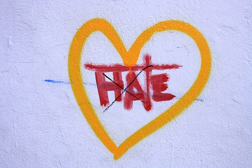

_It probably isn’t worth it._

<!-- more -->

Let’s start from the end- 3 weeks ago I joined [WeWork](https://www.wework.com/). I can now start explaining to you why it’s a great place or why I’m so happy here and why you should come to work with me, but it’s not that kind of post.

**Instead, I want to focus on the other side: why I switched my jobs in the first place and why I didn’t choose other companies.**

I first heard about WeWork in April this year. I talked with some people there and the first thing that caught my attention is the company’s tagline: **_“Do what you love”._**

I was like _“oh god, can I watch football and drink beer all day?!” *rolling my eyes*._

> No! for most people, for most of the time — you can’t just do what you love.

#### **But _you don’t have to do what you hate_**.

That rephrasing might work better for most of us — although it’s less sexy than the original slogan, so I don’t blame the marketing team. :)

It’s also more realistic. No one loves fixing bugs and doing maintenance (at least most of us) — and it’s more exciting to build things from scratch. But let’s be real — you’re probably going to do some from both.

In that point, after some interesting conversations with great people, I decided that I need to better understand what I like to do and more important: what I don’t like to do.

By now you probably know what [I love most about startups](https://medium.com/the-startup-nation/run-fast-fall-frequently-get-up-faster-and-go-drink-beer-at-the-beach-what-it-s-like-to-work-at-9966c365633b#.k33wb7xg3), and more likely what [I hate](/blog/2016/10/11/fuck-you-startup-world/). But I needed something more specific, I needed to come up with some kind of list of things that I won’t compromise on when I’ll choose my next gig.

But before that, let me emphasize a bit more about the different between “Do what you love” and “Don’t do what you hate”:

- I **love**football, I would be happy to work on a product around football, for example- [90min](http://www.90min.com/). But it’s ok if I won’t.
- I **hate** tricking my customers without really give them a real value. That’s why I won’t work for all those [toolbars companies](http://www.makeuseof.com/tag/4-annoying-browser-toolbars-get-rid/).

Do you get it? For me, hating is much a stronger feeling and this is something that I’ll find harder to overcome. Sure, it’ll be great if things will align with the things I love, but that’s a lower priority.

_Photo credits: [Miss_millions](http://images.mediachain.io/image/6b0f777b0e4c2f3c75cc936ef5f58ec0)_

### So what do you hate?

Try to remember this meeting about the new feature they wanted to add to your product that you didn’t understand why the hell your users will want. Try to remember that one day you were so edgy that you wanted to kill one of your colleagues. Try to remember how hard was it for you when you had to write this piece of code, so hard that your skin was itching.

_If that was hitting a nerve, I bet you’ll remember it._

#### For example, here is a partial list of things that I hate:

- Spending time building things that I wouldn’t use and I don’t understand why anyone will ever use them.
- Working in an environment where I’m not constantly learning new things.
- Doing more of the same, not being multi-functional.
- Wasting most of my time not focusing on the core business- commuting to work, bureaucracy, lots of long meetings etc…

That might sound too generic but think of those things that are not on the list.

For example, I don’t really care about my salary, I wouldn’t work for free but most of the time that won’t be an issue.

I don’t mind what my title will be, I don’t think it matters. I don’t care what programming language I use, or if it’ll be backend position or front end — I have some preferences but I don’t hate any of them.

I won’t ignore all your disadvantage because you fly me twice a year to your offices abroad.

_Oh and you already know what I think about free snacks and unlimited vacation days, right?_

Imagine your body as a battery, aiming for keeping it fully charged in energy as possible- doing something that you hate will drain your battery much quicker than doing what you love will recharge it. I’m not sure how much scientific backed this assumption is, I might read it somewhere, but I saw this is the case for me. It’s much like people [hate losing much more than they like winning](https://medium.com/startup-grind/cognitive-bias-ad5f9fe7f59b).

> Once what I hate is off the table, it’s easier to focus on the things I love.

> **Would love to hear what you hate doing. What are the things that you won’t compromise on?**

_Originally published on [Medium](https://medium.com/startup-grind/dont-do-what-you-hate-704325b073d9)._
