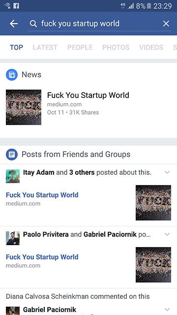

On October 11 I published [a post about the startup world](/blog/2016/10/11/fuck-you-startup-world/). This story went viral, like really viral, much more than I was expecting or ready for. This is my story:

<!-- more -->

### Background for writing the original piece

First of all, in contrast to what some people thought (and wrote in comments)- I wasn’t fired. Nor did I post it because I was rejected by some big company in the Valley. Also, it wasn’t like something happened that was the last straw.

The situation was more like this: every time I saw something weird around me, or read some crazy article about the new thing that is happening in the startup world- I wrote about it in my drafts. After a couple of weeks, I had enough material to write about.

The story is supposed to be sarcastic, from someone that lives inside this bubble and tries to look at it from the outside. It was also a self-criticism, after I took a look at myself and what I’ve become. Some people somehow missed the last sentence in that post: **“_But more than all, start-up world, fuck you for making me one of you.”_**

### Going viral

That’s actually a funny story. That wasn’t the first time that I had published a story on Medium. I’m used to getting a low traffic for my posts (dozens of views, a couple of recommendations). So on the morning of that Tuesday, I published the story without any special hopes.

Because, as opposed to most of my posts, this wasn’t a technical post, I decided to post it on my Facebook page and got 4 likes or something like that. This made me think that I should replace it with my daughter’s picture to get more likes. So far, business as usual.

And here is the funny part- that was [Yom Kippur](/blog/2016/11/06/why-every-country-should-have-some-kind-of-yom-kippur/) in Israel, so after a couple of hours, I went offline for more than 24 hours. So basically this thing exploded without me knowing anything. In the one day of the year that I was disconnected from the world- I got as many of notifications as I had gotten my entire life. Just imagine that you turn on your phone and for 5 minutes it’s not responding because of all the Twitter, Facebook, LinkedIn, Whatsapp and email notifications. Slowly I started to understand what was happening.

### So how did it happen and why this post?

I don’t know, probably no one really has the formula for what will gain readers’ attention and what will not. I can only guess.

First of all, of course, is the language. Using so many swear words made the text stand out. I’m not saying that from now on you need to use profanity in your posts. In most cases using this language will offend your readers. You should think a lot about when it is suitable and use it carefully.

I was lucky enough to find a great cover photo. That helped a lot when people shared it over the social networks. I was even more lucky to have a great friend like [Omri Aloni](https://medium.com/u/42367f168051) help me write it, go over my broken English and make the text more biting.

The mass effect was probably from [Reddit](https://www.reddit.com/r/all/search?q=Fuck+You+Startup+World) and [Hacker News](https://news.ycombinator.com/item?id=12682944) where at some point they even asked people to stop submitting the post:

The next phase was Facebook and Twitter, where the big audience is:

_Couple of days after posting: 31K shares_

I was exciting seeing even [Ray Wenderlich](https://medium.com/u/900122d78d2c)- the one that taught me everything I know about iOS programming, sharing my post:

### Responses

It seems like the post epitomizes what a lot of people feel about our current work culture. I got so many responses that I had no way yo answer them all. Most of them were from people that felt like me and were emotionally connected to the post, each one touched by another part of the piece. Every comment, even just the “thank you” ones, made me delighted.

Some might miss the point, writing things like “_Book a week? I’m reading a book a day_” or _“What’s wrong with a standing desk?”_ and things like that. To them I want to say- nothing wrong. I use a standing desk sometimes and there are books that I read in a couple of hours, but look at the bigger picture. Don’t do things just because everyone is doing them. It’s not worth anything if you finish reading the book just for the sake of telling everyone that you read it, like you have some kind of checklist. Take your time, chill, have fun.

I thank each one of you that took the time and read what I had to say and cared so much that he or she even posted a response, even if it’s just to tell me I’m worth nothing if I can’t shift a bit on a whiteboard =)

### Follow-ups

This piece made some noise, and after a couple of days, I started to get some direct emails and messages. Most of them were surely lost in the endless stream of notifications (sorry for that). Some wanted to translate the article (for example to [Hebrew](http://www.blazermagazine.co.il/posts-general/38202/), [French](https://medium.com/@nesvonaissa/jemmerde-le-monde-des-start-ups-5437be5061bc#.dnq2p73wt) and even [Korean](http://five0203.tumblr.com/post/151876107794/%E3%85%88%EA%B9%8C%EB%9D%BC-%EC%8A%A4%ED%83%80%ED%8A%B8%EC%97%85-%EC%84%B8%EC%83%81%EC%95%84)).

There were a couple of follow-ups articles about the startup culture, and why this post got so much traction (like [here in IBTimes](http://www.ibtimes.co.uk/fk-you-silicon-valley-developer-rants-about-madness-todays-global-startup-culture-1586855) and even here to a [Norwegians audience](https://nrkbeta.no/2016/10/13/faen-ta-deg-startup-verden/)). I also got the chance to talk with [Paul Kemp](https://medium.com/u/f121e3fec16c) in his [wonderful podcast](http://www.theappguy.co/the-app-guy-podcast/2016/10/24/tagp496-shem-magnezi-fuck-you-startup-world).

But the cherry on top was the article in [CNBC](http://www.cnbc.com/2016/10/13/a-furious-anti-silicon-valley-rant-goes-viral.html).

The bottom line is that I’m happy that my post brought a discussion of this topic and made us think about where we’re going with this kind of trend.

### The startup world video

Shortly after my post came viral, I got few messages from some independent video producer wanting to do something with this piece. Lucky enough one of them was a brand new cool indie company called [SpaceCat](https://www.facebook.com/SpaceCatStorytelling/?fref=nf).  
We took our time; they did an excellent job doing the hard work- taking my words and bring them to a visual medium.  
They gathered the most successful well-known startup figures in Israel to collaborate and participate in the piece.  
We worked shoulder to shoulder making sure the text works and make sense, taking only the juice for a short clip and deliver the right message.  
It ended up with one of the most beautiful, funny and well-crafted things that I could imagine.  
Special shout out for [Liat Yoffe](https://medium.com/u/30ffc309a2a7), Erez Markovich and Mika Josting for the great work that they did here.

### Some numbers

- Most popular story in Medium 5 days in a row
- 370k views in one day
- 1M views total (and counting)
- More than 80k shares on Facebook (that’s actually something that is hard to track, because when I added my story to publication, the URL changed and the shares count on Facebook was reset)
- Not sure about that- but looks like it’s got to the top 5 Medium recommended stories. (Edit: ok, wow, it was [#2 article on Medium in 2016](https://medium.com/startup-grind/mediums-most-recommended-stories-of-2016-171efdd705c5#.evomxxe0i))
- Lots more followers in Medium and Twitter.

### Final words

My online footprint changed drastically. This was a hell of a ride and, to be realistic, probably a once in a lifetime experience.

Now if you will excuse me, I’ll go back to writing about boring stuff like doing some [icons animation in Android](/blog/2016/02/25/animated-vector-drawable/).

_Originally published on [Medium](https://medium.com/@shemag8/when-your-story-go-viral-8a1c84ad0fdb)._
