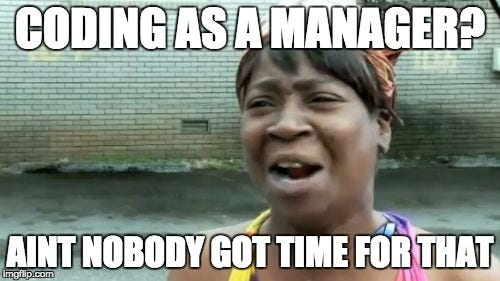

_And that’s ok_

<!-- more -->

When I started my journey in a startup, I was the first employee there, so I was the most junior developer in the company and also the most experienced one, I was in charge of my own on-boarding, I was the mentor and the mentee. [It was a great time](https://medium.com/the-startup-nation/run-fast-fall-frequently-get-up-faster-and-go-drink-beer-at-the-beach-what-it-s-like-to-work-at-9966c365633b), just like living in the jungle without really thinking where you’re heading.

We didn’t think about our job titles, even after we got a bit bigger. Because first - we didn’t have the time, and second- in a 7 person company, where the CEO closes support tickets and the developer sits with investors- titles don’t really matter. So no one had a clear path for their career growth.

This might be a good thing- when there’re no titles you don’t think about promotions. No one is thinking about themselves, what their next position is, or how to get there. Everyone focuses more on the company goals rather than the individual’s objectives.

But, it also has a downside. You might forget about yourself and your own career. While startups are great for developing a tool set for creating stuff from scratch as an individual, I think there is a whole new aspect that you’re not going to develop- to grow yourself in an organization and learn how to work in teams bigger than just you.

That’s why when our startup was acquired, and we joined a big corporation, I thought the next step for me was leading a team.

### The developer dilemma

Most of the tech organizations are structured as a pyramid, when on top sits the VP R&D (or CTO), then come different kinds of layers of managers (and managers of managers) and at the bottom- the developers.

So when a new hire joins the development department, they usually join as a new team member. As time goes by, and if they are good enough- they advance in the managerial path and slowly replace their coding time with meeting time.

This is how most of the companies I know are operating, and this is also the situation I found myself in.

#### What’s the problem with this?

_First_, in this kind of [tree structure](https://en.wikipedia.org/wiki/Tree_%28data_structure%29) (where every manager manages more than one team member), the _leaves number_ (the regular developers) make up at least half of the whole organization. Meaning, that even given a high turnover, not everyone is going to have a seat in the upper level.

A workplace where many people compete for very few spots leads to (a) a very competitive environment with tension between colleagues, and (b) good people who deserve promotions end up stagnating because there is just not enough room for everyone.

_Secondly_, when promoting good **engineers,** you expect them to be good **managers** as well, although the two are different roles that require different skill sets. In real life, what happens many times is that you promote good developers to be not-so-good managers just because they were so good at writing code.

_Lastly_, engineers that don’t want to manage people, or are just not good at it, are going to be stuck in the same position without any real path for advancement.

### Back to me

After a couple of months in the new company, my managers decided to set up a new team with a new product, and they offered me a leadership position in this team.

At this company, every team was composed of developers, one team lead, and one architect. The architect was responsible for helping the team with significant technical challenges, but they didn’t have room for advancement (most of the time they were simply the most senior engineer in the team).

Because the new team was small, I was supposed to fill both roles- lead and architect. I decided to accept the challenge.

#### The beginning wasn’t so good

For starters, I didn’t get any training or mentoring for my new position. It was like everyone thought I would just _figure it out_. So I did what seemed to be the natural thing to do and just copied what my previous managers had done, or at least what I thought they had done.

Soon enough I was drowning. Trying to catch up with emails, syncing with the product manager, sitting with the designer, reporting to my manager and doing 1:1s with my team members.

I was one step behind all the time and always the one who was reacting, never initiating. And I’m not even talking about time to look at the code.

#### Things slowly stablize

After a couple of months as a manager, I finally managed to achieve something really outstanding — I had lunch. Like, a real lunch, outside the office, with real air, sunlight, and all of that. It felt great. Ok, I might be exaggerating a bit here, but I was finally able to anticipate the weeks ahead.

The team started to take on some shape and rhythm, and it seemed like I was able to handle the day to day tasks.

And yet, something was missing- I was still missing out on the technical side. I wasn’t able to wrap my head around simple things in the project because I didn’t have the time to go over the code.

I also felt that I had no real impact on the product or the team members. Again- most of the time I responded to things that happened: product changes, a team member with a problem, bugs, etc.

> I didn’t feel that I was bringing my best, I didn’t feel that I was helping the team, I didn’t feel that I was doing what I love.

The experience might have been too short to adequately judge. This might have gotten better if I had given it more time. It might have happened to a lot of people before or it was just me. The bottom line is that I decided I wanted something else. Something where I could bring more value through coding, because honestly, I was a bit lost in management and the bureaucratic hustle.

### Introducing: The Individual Contributor

Many companies already faced these kind of problems with their engineers. That’s why some of them came up with an alternative to the management path- _The Individual Contributor (IC)_ path.

Up until recently, it was “a thing” only within big companies like Facebook, Google or Microsoft, but today, smaller companies have also adopted this kind of IC track. Companies like [Spotify](https://labs.spotify.com/2016/02/08/technical-career-path/), [Buffer](https://open.buffer.com/engineering-career-framework/), [Run the Runway](http://dresscode.renttherunway.com/blog/ladder) and even [Medium](https://medium.com/s/engineering-growth-framework/engineering-growth-introduction-8ba7b78c8d6c) started sharing their IC program.

#### What is the Individual Contributor career path?

IC career path (or track, or ladder, or whatever you want to call it) is a framework for someone to grow by focusing more on the technical vector than the administrative one.

#### Does growing mean they are typing on their keyboard faster?

Not exactly. Like the old saying:

> “The easiest way to be a 10x engineer is to make 5 other people 2x.”

Yes, you can do it by improving the code, but also by making the process better, introduce new concepts, mentor individuals and [much more](http://redmonk.com/fryan/2016/12/12/on-the-myth-of-the-10x-engineer-and-the-reality-of-the-distinguished-engineer/).

#### What does it look like

Every company does it a bit differently (you can go and check with the examples above), but the basics are similar: just like managers going from managing a small team, then leading a team of teams, and so on, ICs are increasing their influence from team level to a department level and later to an all company level.

How exactly to do it is not so straightforward and can vary from one developer to another and between companies. A new and dedicated post should only talk about that (soon, I promise).

### What about you?

I’m fine, thank you for asking.

As I said- I wasn’t satisfied with the management path, and I wanted to find something that was more hands-on and technical.  
That’s why I was happy to find out that WeWork (another company with IC track) was looking for engineers.

Since I joined as a senior engineer (and not as a tech lead), I have felt that I’m making an impact in a tangible way: I’m touching the code a lot, I’m effective and feeling that I’m helping contribute to the team.

### Summary

For me, discovering that I don’t have to be a manager to get promoted in a tech company was a huge relief.

A lot of companies (and individuals) understand now that there is a place for engineers to grow as individuals outside of the management track, and every one of us should know about this alternative.

For me- if I had had the opportunity to read this kind of post, I would have been thinking about my career development differently. I think that many developers out there, because they are not familiar with this concept, choosing to do something that they don’t fully want to, or worse- just give up. This does not have to be the case for us, and for keeping good people in the ecosystem we have to give them the tools and the platform to grow in areas they are good at and they love.

So I hope that somewhere in the audience there is the “me 2 years ago” and I was able to help you.

_Originally published on [Medium](https://medium.com/@shemag8/not-everyone-is-a-manager-4fe01a329ed1)._
