As a geek I often imagine situations in life as a math equations and graphs (don't you all do it too? What's wrong with you people?!). In this post I'll try to describe some situations is the tech life as graphs:
<!-- more -->

## How excited are you when working in corporate:
 

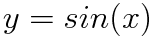

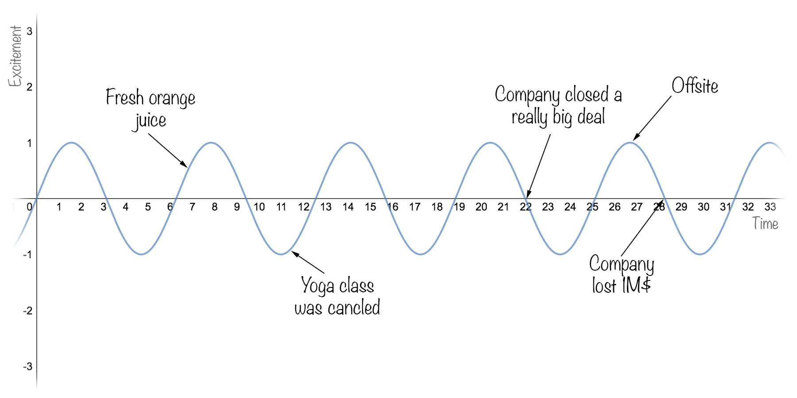

## How excited are you when working in startup:
 

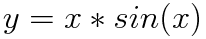

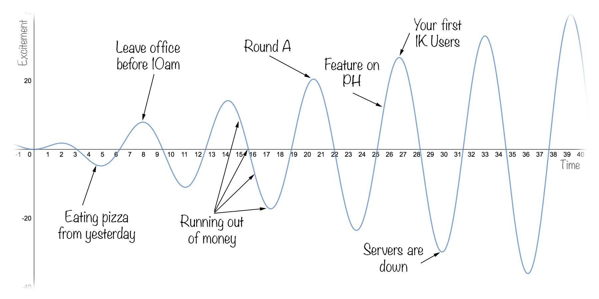

## #Lines of code you write:
 

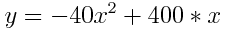

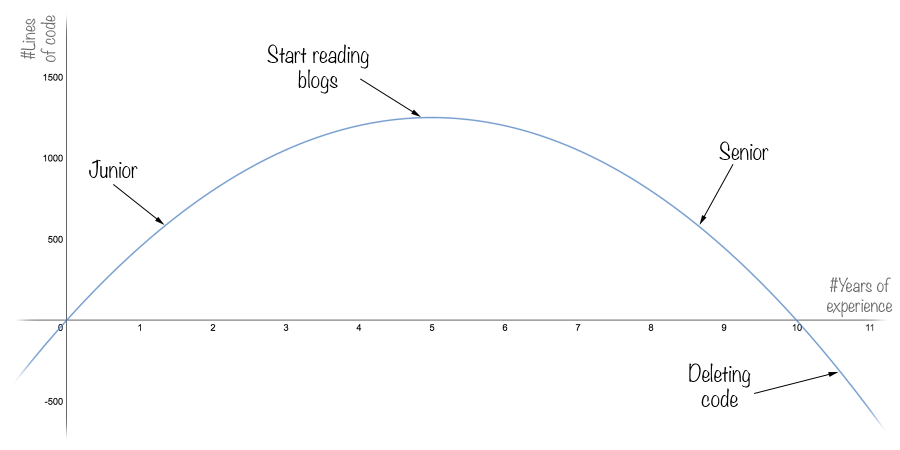

## Startup burn rate:
 

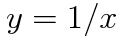

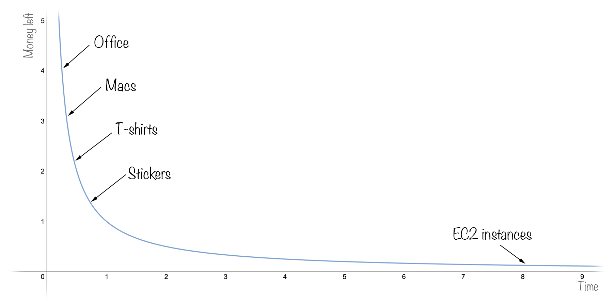

## Do your css rules are working:
 

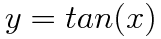

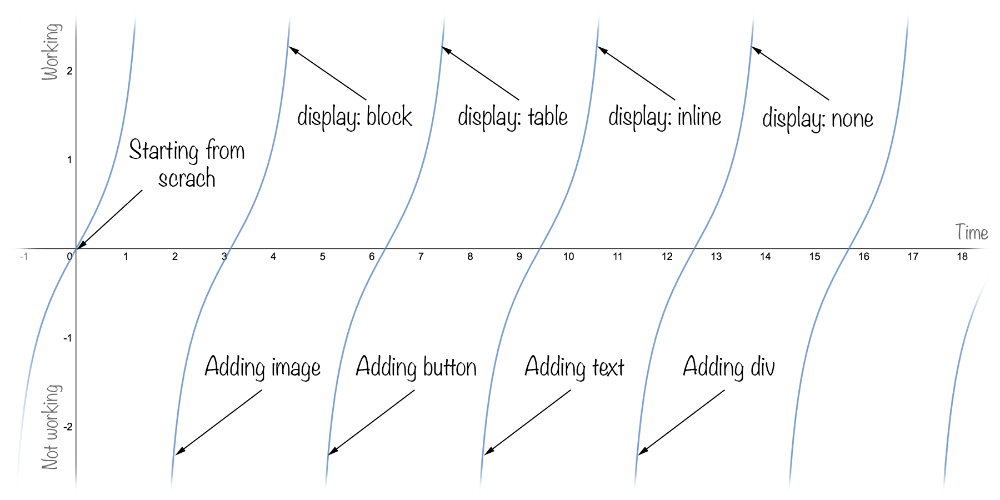

## Number of messages you get from girls- LinkedIn / Tinder
 

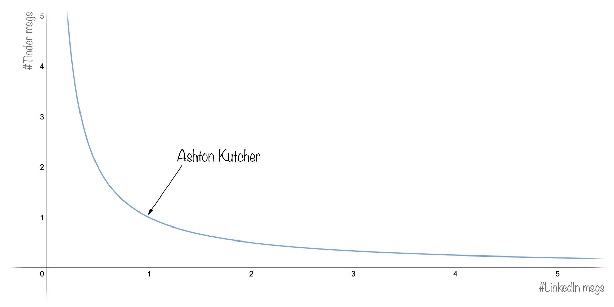

## How much you think you know android:
 

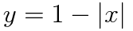

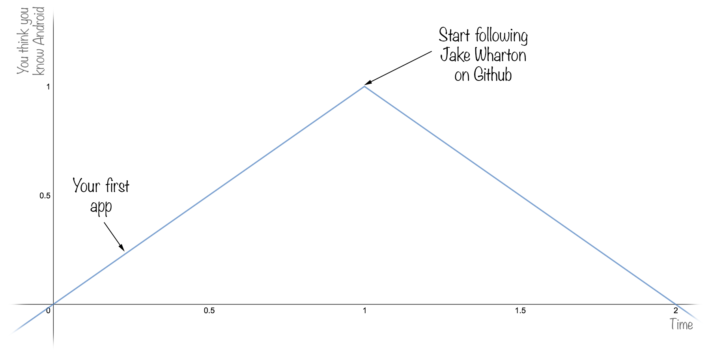

## How much you like your PM:
[Dirichlet function](https://en.wikipedia.org/wiki/Nowhere_continuous_function#Dirichlet_function)

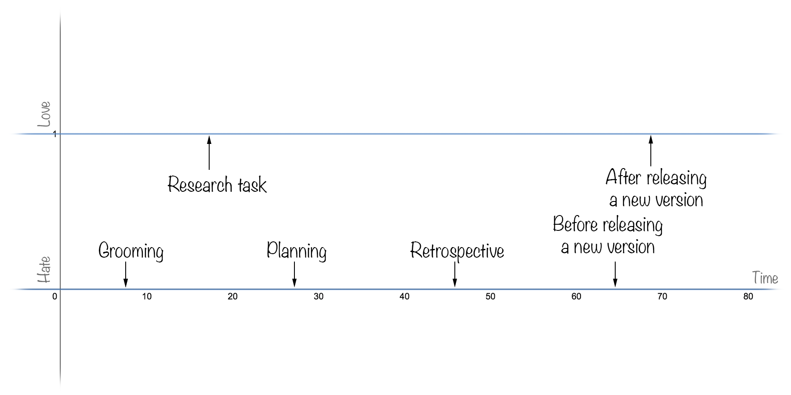

***
 

_Update: looks like people loving some of those graphs, so following couple of requests- you can now get it on shirts or stickers [here](https://teespring.com/stores/geeksshirts)._
  
***
 

*If you enjoyed this post, please hit the “recommend” button below and share this story. I also love reading all comments. Thanks!*
