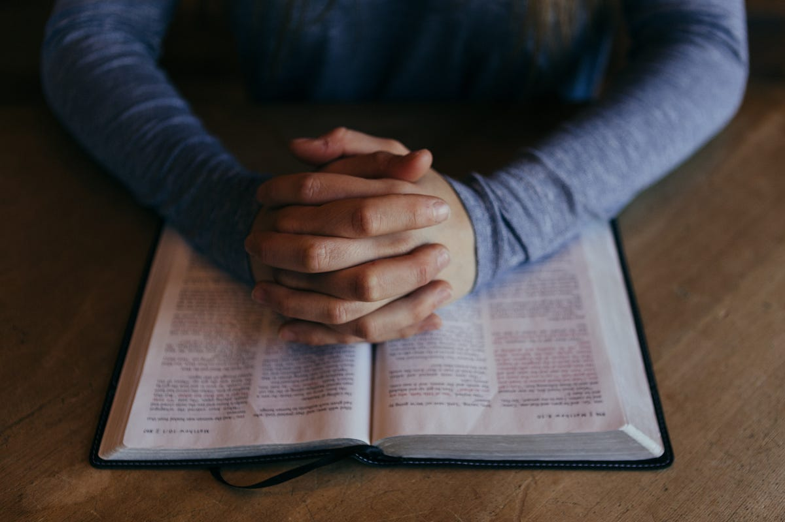
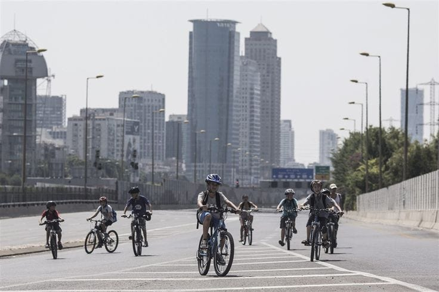
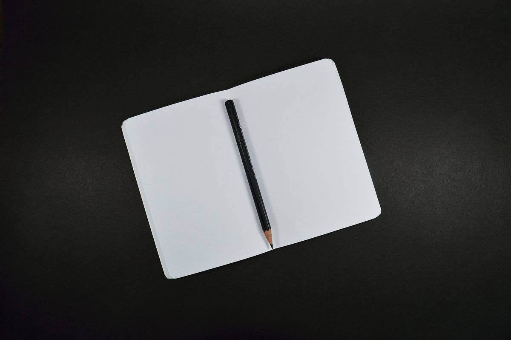

_Calm down, I’m not going to preach to you._

<!-- more -->

If you would wake up in Israel at October 12 this year, you would think that something happened in the world while you was asleep. That was Thursday and there weren’t any cars driving in the streets. The roads were full by kids riding their bikes and tired parents sitting on random street corners among them. From time to time you were able to see people passing by with white blanket on them (the Jewish call it “Talit”). If you wanted to eat something or hang out- you couldn’t, because all the places were closed. And if you opened the TV to check out what’s going on- no channel was broadcast.

Relax, nothing happened, no nuclear war or zombies apocalypse, it’s just Yom Kippur:

> **Yom Kippur**, also known as **Day of Atonement**, is the holiest day of the year in [Judaism](https://en.wikipedia.org/wiki/Judaism). Its central themes are [atonement](https://en.wikipedia.org/wiki/Atonement_in_Judaism) and [repentance](https://en.wikipedia.org/wiki/Repentance_in_Judaism). Jewish people traditionally observe this holy day with an approximate 25-hour period of [fasting](https://en.wikipedia.org/wiki/Ta%27anit) and intensive [prayer](https://en.wikipedia.org/wiki/Jewish_services), often spending most of the day in [synagogue](https://en.wikipedia.org/wiki/Synagogue) services.

> Source: [Wikipedia](https://en.wikipedia.org/wiki/Yom_Kippur)

In traditional Judaism, Yom Kippur is one of the important days of the year. It’s a religious day with a lot of prohibitions and laws. People spends most of the day at the worshipers praying. Also, because Israel is the religious country- shops and businesses are closed that day (with exceptions like hospitals and other emergency services).

Imagine yourself how would you spend a whole day without electricity- no computer, no smartphones, no internet, no Facebook or Twitter. You can’t watch TV or play Xbox. If you want a light in your house you need to think of it before and turn on the lights before the holiday (and keep it on all day and night!). You can’t call you friends or parents to ask them how are they. You don’t know if there is a war or something on the other side of the country. No elevators or cars- so get ready to move your body. And as an addition to all this- people are fasting.

> Not that simple right?

_Credits: EPA_

Although most of the population in Israel not consider themselves religious and not living an orthodox life during the year- most of the people do respect this holiday and keeping some of this day’s traditions. Not because of religious reasons, but for some kind of social aspects that this day has.

The main theme of Yom Kippur is Repentance and Atonement. According to Jewish tradition- God inscribes each person’s fate for the coming year into a book and seal the verdict on Yom Kippur. So in this day (and the days before) each one and one of us should think with himself and look back on the last year, thinking about things he regrets and want to ask for forgiveness. You should also be looking forward to the next year and decide how you want to be a better person.

But if we disconnect for one moment from the religious aspects of this holiday and think of it as a more spiritual process- you don’t need to believe in god to relate to this approach. Everyone do some things that he or she regrets about, some seeing it as eating a cheeseburger (It’s not Kosher for jews =0), while others can think about the time she was impatient to one of her children.

This opportunity- to stop everything you do on your day to day, take a step back and analyze what you’ve done in the last month / year / decade- is one of a kind. In the modern world that we’re living, we chasing after so many things, that we don’t get a chance to stop and think.

[Louis C.K. described it perfectly](https://www.youtube.com/watch?v=5HbYScltf1c):

> _You need to build an ability to just be yourself and not be doing something. That’s what the phones are taking away, is the ability to just sit there. That’s being a person._

And this magic, the quiet that Yom Kippur has, it’s a great chance to just disconnect. To get our head out of the screen and look up. Again- most of the population in Israel isn’t religious, most of them don’t fast and not going to worshipers, but still- you won’t see many people using their phones on the streets. Children are going out of their rooms and spending this day going out and cycling on the empty roads (just think on the Air pollution that drops).

So maybe we’ll try for one day, just for one day, to take a time out from our super busy life, and go back- to the simple things, give you body and mind some rest, before going back to our rat race.

_Originally published on [Medium](https://medium.com/@shemag8/why-every-country-should-have-some-kind-of-yom-kippur-4c165c487398)._
