[Another part](/blog/2016/06/03/life-as-graphs/) of me trying to visualize situations of my tech life as graphs
<!-- more -->

## Native apps
 

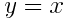
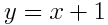

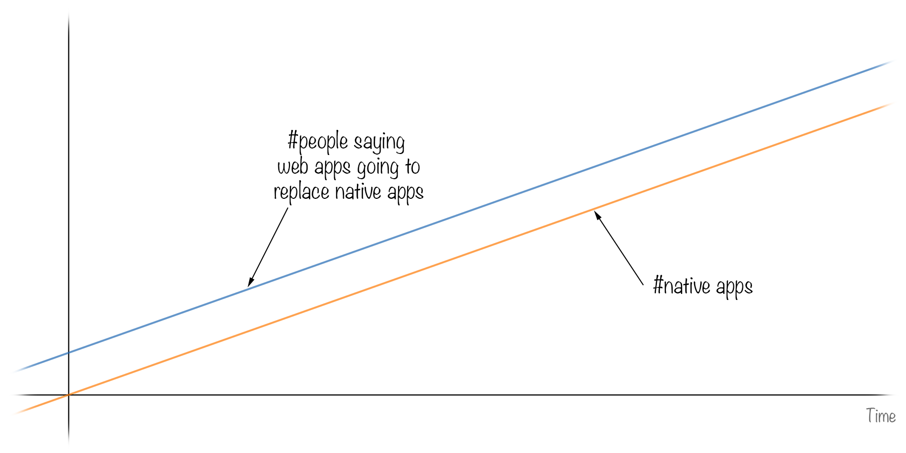

## Pair programing
 

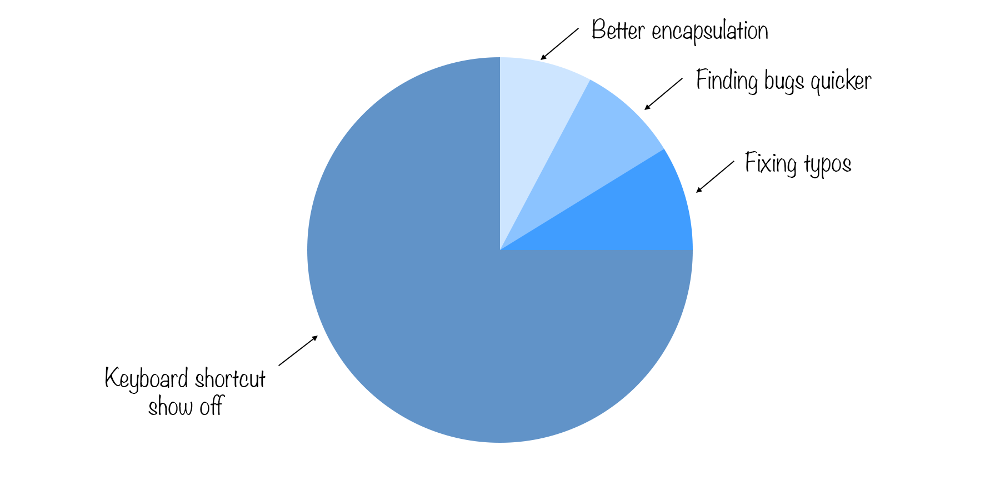

## Ruby on Rails magic
 

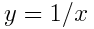

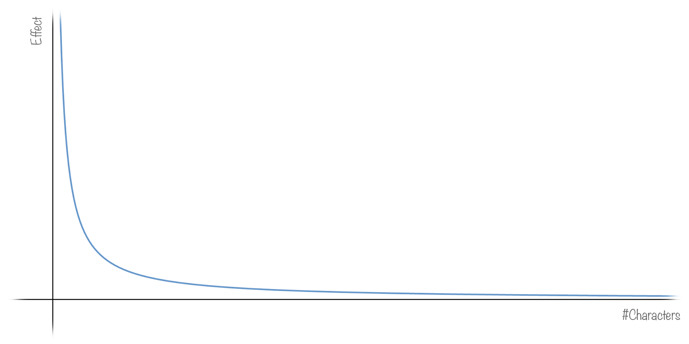

## Public speaking
 

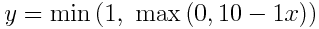

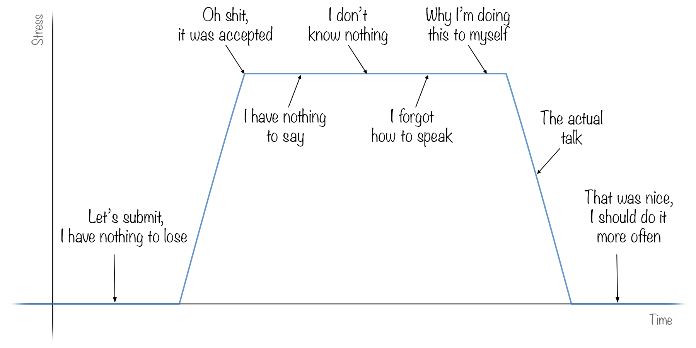

## JS hype
 

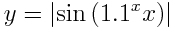

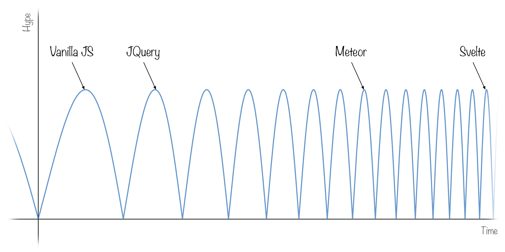

## Working hours
 

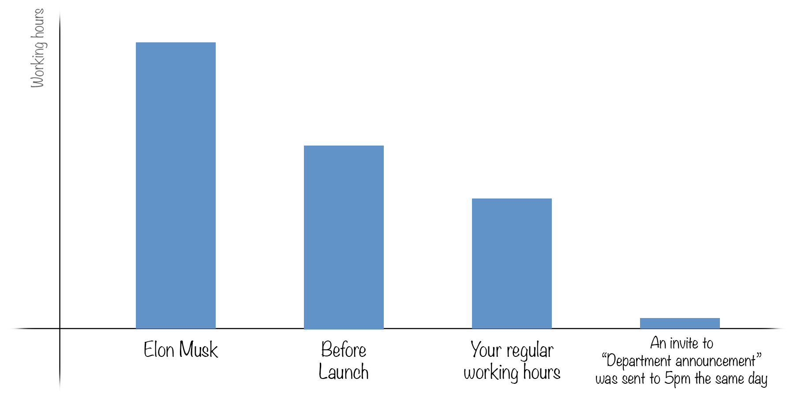

## Pull requests
 

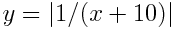

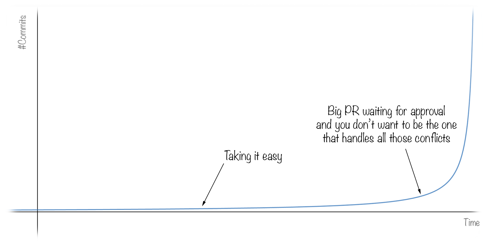

## When watching [Wes Bos](http://wesbos.com/) JS tutorials
 

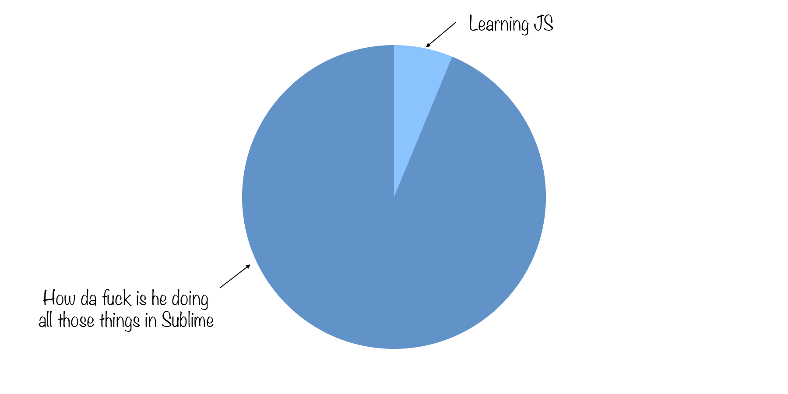

## Emails
 

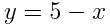

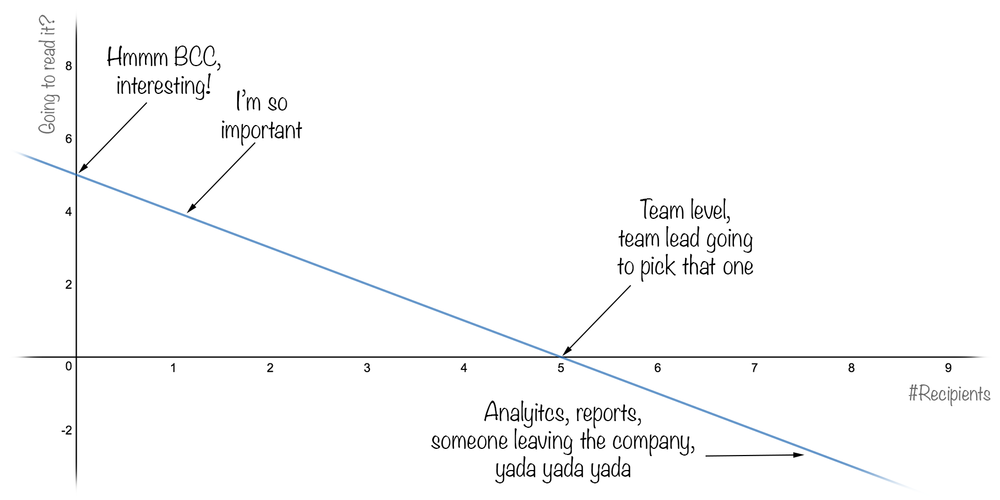

***
 

*If you liked this post click the ♡ bellow and share this story. As a writer it means the world.*
