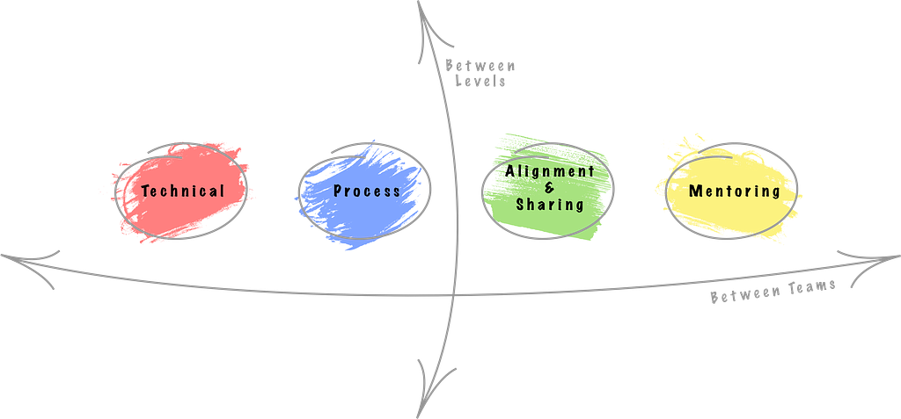

_Or- how to grow as an Individual Contributor_

<!-- more -->

In my [previous post](/blog/2017/11/28/not-everyone-is-a-manager/), I talked about the opportunities you have in technology companies as an individual contributor and what are the alternatives for advancements, other than being a manager.

So let’s say I convinced you, and you want to check out this IC track. In this post, I want to focus on how you should do it. What the things are that make a senior engineer a good one and what the steps to become one.

### The Senior Engineer mission as I see it.

First and foremost important thing that we are here for is to help our company work better and deliver better products. This is a bit of a vague mission, and we’ll try to break it down later.

This mission should be in mind for everyone in the company (and I genuinely believe that each team member is a tech lead at some level) but building better products easier should be the #1 priority for ICs, and that’s how they should be measured.

> **We can divide the ICs work into two vectors with a couple of pillars in each one of them. First let’s start with the vectors:**

### Vectors

Vectors are the boundaries or areas we should look into when we want to make an impact, there are 2 options:

#### Vertical

Here the impact can be down (to the team/ department you’re responsible for) or up (upper to the management, or things to change at the company level).

#### Horizontal

Here the impact is to the sides- to different teams, to different departments, or with another ICs from other teams.

> ICs need to understand that they need to look at “company level” problems and affect people outside of their team. They are responsible for giving feedback upwards, sharing things between groups and generally looking at the bigger picture.

### Pillars

Pillars are the areas or aspects in which each IC can affect the team or the product. This is the skill set seniors should acquire in order to be better at what they do. Here we have 4 pillars, and I’ll explain for each one why I think this skill is important and give examples on how to do it.

### 1. Technical

First and foremost, you should have great technical skills, because at the end of the day we are here to build a software product.

They should have strong skills in computer science and system architecture. They should know to detect code smells and code debt. They should be familiar with all kind of design paradigms.

It would also be great if they have a deep understanding of the team’s specific domain- whether this is frontend, server side, databases, etc.

It doesn’t end with knowing just the theoretical stuff, but it also is about implementing and having real experience in those fields. You should be a hands-on and be able to build real things, not just familiar with all the buzzwords.

#### Why?

I think this is straightforward- as part of your responsibilities, you are also responsible for the code quality of the system. You should use your experience and knowledge to keep the technical standard high and address issues as early as possible.

#### Examples

- Be familiar with the common [design patterns](https://en.wikipedia.org/wiki/Software_design_pattern).
- Write [multi-threaded](https://en.wikipedia.org/wiki/Multithreading_%28computer_architecture%29) code and debug it after you (obviously) forgot one edge case.
- Have a couple of years of experience in building apps and pushing them to production.
- Know all kinds of paradigms for system architecture like [MVC](https://en.wikipedia.org/wiki/Model%E2%80%93view%E2%80%93controller), [SOA](https://en.wikipedia.org/wiki/Service-oriented_architecture), [Micro-Services](https://en.wikipedia.org/wiki/Microservices), [SOLID](https://en.wikipedia.org/wiki/SOLID_%28object-oriented_design%29), [Clean Architecture](https://8thlight.com/blog/uncle-bob/2012/08/13/the-clean-architecture.html) and so on.
- Write code. Read code. A lot.
- Know the Activity lifecycle (for Android teams) / The component lifecycle (React) / when to set an index (working with DB) / Active Records hooks (rails) / etc.

### 2. Process

As part of looking at the big picture, seniors should help with the process of how things are happening in the team or the company. They should also share their former experience from previous places and groups the were work at.

They’re the ones that should raise their voice and say “I don’t think this is the right way to do this kind of thing” when the others probably won’t notice anything wrong.

#### Why?

They know how right processes help individuals to succeed and how bad processes can lead to failure and frustration.

#### Examples

- Is it easy for us to deploy new code to production?
- Are having too many stupid bugs in production that we can quickly eliminate?
- Is our onboarding process giving enough context to the new hire?
- Are our code reviews helpful?
- Are we able to easily get into a code of another developer from the team? To another team’s repository?

### 3. Alignment & Sharing

Another aspect of the senior’s job is to keep track of other teams or groups and make sure they’re all aligned in some sense.

It can be a new ritual that another team does to be more productive or a new technology that can help them to handle the load. That’s also mean they need to be aligned with the product (in their team or the company’s direction in general) so the systems will be able to support new features along the way, or remove unnecessary use cases that are not relevant.

It also works the other way around- they should share great things that are happening in their team to the outside world, these can be other teams or even a group of people in a conference.

That means that they should be good communicators- they should listen and pay attention and should be able to explaining themselves and know how to tell a story.

#### Why?

ICs should have the ability to take a step back and (again) look at the bigger picture. They should have the capacity to see what others are doing and learn from them. This is a critical skill to understand what one can learn from others and copy it or share it.

This is also important at a company level so that the teams are aligned and the best methods are shared across all divisions.

#### Examples

- Participate in other teams’ [retrospectives](https://www.scrum.org/resources/what-is-a-sprint-retrospective) to understand the team better.
- Create a senior engineers forum to share ideas.
- Read a lot about how others solved and are solving similar challenges that your team might be facing.
- Talk at conferences and share awesome things that your company has done lately.
- Setup a workshop and share your knowledge.

### 4. Mentoring

This is my favorite part, and something that I feel is the most undervalued aspect of the senior’s roles.

As said before- one of the senior’s roles is to improve their team (the down vector), and part of it is to make the individuals better.

ICs should also prepare the next generation of seniors, whether because they will leave the company one day or just move to the next level.

They should share their experiences because everyone started a junior and for each person, these were hard times.

This is also the most rewarding part of the job because you get to interact with people and affect them directly.

#### Why

This is very important for an organization to cultivate the next generation of leaders internally. As an individual contributor, it’s also necessary that you encourage the next generation on their journey and to choose the technical career path.

#### Examples

- 1 on 1 sessions with specific team members
- Office hours
- Take a team member and pick a big project to work on together.

### OK, that’s kinda a lot of stuff don’t you think?

First- yes, that’s a lot to do and be responsible for, no one said it would be easy.

Secondly, you don’t have to be very good at everything. We need to understand that just like managers have different ways to lead teams, ICs can have different ways to make an impact, and each senior engineer can focus differently on each vector or pillar.

So make sure you have the necessary skills in each one of the above and choose one or two points that you want to focus on.

### It seems like a lot of the things we talked about are somehow overlapping with the managerial position’s responsibilities

That’s a valid point. As I see it, the senior engineer should work side by side with the team lead (or staff engineer with the department lead and so on).   
These two should be synced with where they want the team to head. Most of these decisions should be made in synergy, although in the end, the team lead will have the final word.

### Anything else?

Actually, if you got this far, I really recommend this talk by Randall Koutnik and his take on senior developers and their role:

<iframe width="560" height="315" src="https://www.youtube.com/embed/yIPbE7BssOs" frameborder="0" allowfullscreen></iframe>

_Originally published on [Medium](https://medium.com/@shemag8/so-you-are-a-senior-engineer-now-what-35ee2116f635)._
