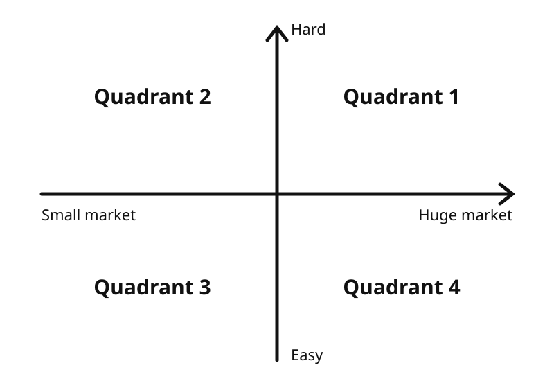

_For choosing a workplace, or for when a friend at a bar has "the next unicorn, bro"._

<!-- more -->

I should be working on my talk for Reversim, so of course I'm procrastinating and writing this instead.

This isn't a personal story, it's a framework that helps me evaluate ideas. I should say I didn't read about it anywhere. It's just something I slowly built for myself in my head, out of observation and past experience.

Every startup begins with a team that has to come together around an idea (not necessarily in that order). As I've said before, I don't think the idea is that important, and it doesn't need to be airtight. On the contrary, you need some flexibility, because the idea is going to change a thousand times.

But what do you do when you're thinking about an idea? At first a lot of ideas come up, each of which could take the company somewhere else. They'll all look genius at first, and an hour later they'll look stupid.

To help me evaluate an idea, I put it on a set of axes. The X axis is the size of the market, and the Y axis is the difficulty.

**Difficulty** of solving the problem can be technological (very specific knowledge), procedural (FDA approvals) or about market penetration (getting people to host strangers in their homes). Difficulty is relative, and what's hard for one team can be easy for another.

**Market size** is usually measured as total addressable market (TAM), or as we say in Israel: "how much money is in there?" For example, there are hundreds of millions of mobile users, but none of them spends too much on apps. On the other hand, there aren't many people working in enterprise security, but everyone knows there's a sea of money there.

Now let's map each quadrant. To quote my partner On Freund: "the interesting part is on the diagonals".

## Quadrant 1: hard problem, huge market

These are the classic VC companies. There's a huge market waiting for a solution, and if the team can solve this hard problem, there's bonanza potential.

Examples: DoorDash (operations at scale), Stitch Fix (an algorithm for a recommendation engine that works), Intuit (bureaucracy).

- **Pros:** if you make it through the difficulty (usually a big "if"), there's potential for big money.
- **Cons:** you need to find someone who'll believe in you and put money on you, commitment, long cycles.

There's also a subgroup here: super hard problems in an enormous market. Because of the nature of these problems, there's an underserved audience just waiting for a solution. The players here are the tech giants, because they have tons of money, talent and influence, and they're thirsty for more market share.

Examples: robots (Amazon), smart cities (Google), internet in third-world countries (Facebook).

## Quadrant 2: hard problem, small market

On paper this quadrant isn't worth the investment, but companies here are betting on a market that keeps growing. The rationale is that if and when the market gets there, they'll be first in line with the knowledge and the product.

Examples: Beyond Meat (bet on the vegetarian trend), Twilio (SaaS developers), the first mobile developers.

- **Pros:** the thrill of being pioneers, and if you solve it but the market doesn't get there, potential for a good acquisition.
- **Cons:** a big bet (on both the solution and the market), and you really have to time the market (being early isn't good either).

## Quadrant 3: easy problem, small market

Classic bootstrap products. DHH says that to reach a million dollars in annual revenue, all you need is 1,000 users paying you $100 a month. Numbers like that are something you can bring in from the garage. On the other hand, funds will shut the door as soon as they see them.

Examples: Basecamp, and thousands of companies you haven't heard of because they make great money and save on PR.

- **Pros:** no big investment or commitment at the start, you can begin while working, passive income.
- **Cons:** finding users is very hard, and the moment you're onto something, someone will copy the product.

## Quadrant 4: easy problem, big market

Supposedly the holy grail. But as my economics lecturer said (I didn't study economics): if they told me there was $100 on the floor, I wouldn't believe it, because if there were, someone would have already picked it up.

So I always look strangely at a company that says it's in this area. It will usually be a crowded market (a red ocean), full of big, veteran companies all competing over fractions of a percent.

Examples: simple mobile apps, drop shipping, the world of advertising.

- **Pros:** a fast track to acquisition by one of the companies already in the field.
- **Cons:** competition isn't healthy for a business, certainly not against veterans.

## What's next

Two follow-ups I'd like to write and hope I remember: movement between quadrants, because the market is dynamic and companies keep moving along the axes, and how we used this framework to rule out ideas very early, because we knew up front we wanted to live in quadrant 1.

This has been sitting in my head for a long time and I wanted to put it on paper, because I really think it gives people tools to evaluate ideas and their potential. Whether that's for choosing a workplace, or for when a friend comes to you at a bar with "the next unicorn, bro".

_This post started as a [thread on X](https://x.com/shemag8/status/1433765046903984131)._
