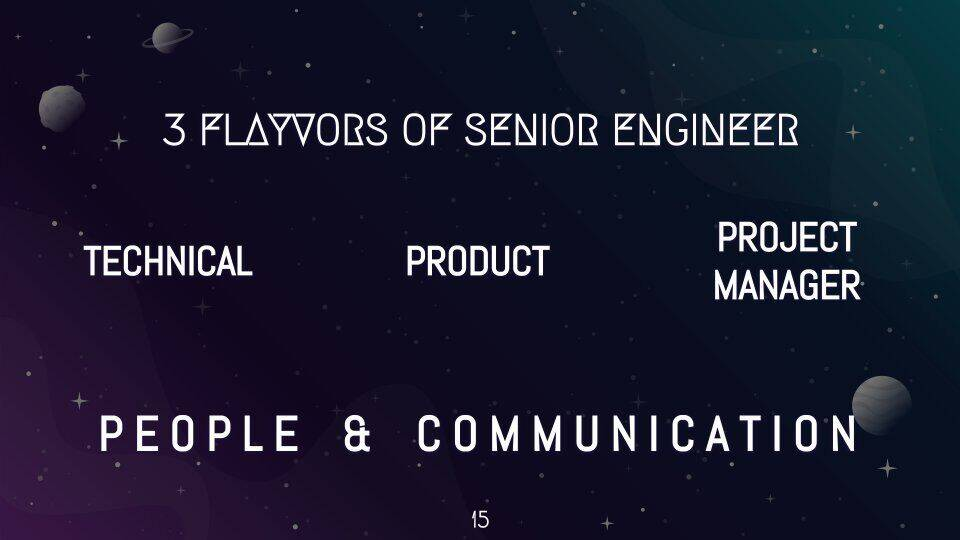
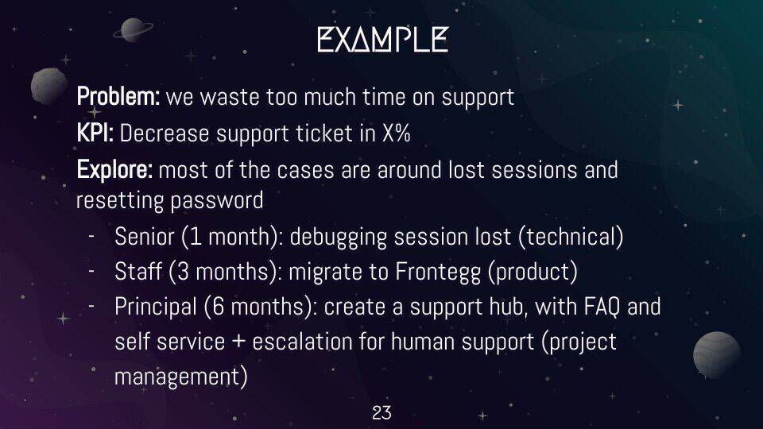

_What got you here won't get you there._

<!-- more -->

This is the written version of [my talk at Reversim](/talks/#the-mysterious-journey-of-becoming-a-senior-engineer), for anyone who missed it.

I've worked in individual contributor roles at WeWork, Facebook and now Wilco: Senior, Staff and CTO (which I also consider more of an IC role).

The story starts when I joined WeWork. In my first team meeting they introduced me and another developer as the seniors of the group. Coming from startups, I thought everyone was senior. I didn't understand that we were *the* seniors. So I had no choice but to go and research it, and [I wrote a bit about what I learned](/blog/2018/01/12/so-you-are-a-senior-engineer-now-what/).

I've learned a lot since then, mainly how to manage yourself day to day. And I realized there are many confused people like me, so we need to start talking about role definitions and expectations more concretely.

## The problem

Most developers' paths look similar. You start by learning what programming even means, and everything is new. Slowly you become more and more independent and get more responsibility. You progress from junior to mid-level, and one day you become the team's knowledge hub, the one who knows all the hidden corners of the code.

And then what?

Until now everything went (relatively) smoothly. You got a task and finished it, got a bigger task and finished that too. Now you want to know what the next step is. You look up and see two options: management or architecture.

Why bother? As an individual, you want more impact and more independence, and advancement often translates into more money. As an organization, you want people to progress because it helps you build strength and helps you retain people.

Sounds good, so what's the problem?

There's a pretty clear, linear, standard path at the start. But when you reach the "senior" worlds, it gets messy: too many titles that say the same thing and at the same time say nothing, and no clarity about what's expected of you or what the difference is between them. Management is a little clearer. That path has existed longer, it exists in other professions, and enough has been said about it. The senior jump is fairly new, and not that intuitive.

There's also a problem between the individual and the company. As an individual I depend heavily on my manager to guide me, because the role definitions don't make it clear what I'm supposed to do. I'm supposed to prove myself through technical projects, and those aren't always on the table, or at least I don't know about them.

It's hard from the manager's side too. Middle managers are the busiest layer in the organization, because they have to handle the high level and also be there for the small details. And they don't have many chances to let people practice safely, because failures have a real cost.

## Change how you think

The first and most important thing is changing your mindset. For the first time on this career graph, what got you here won't get you there.

Until now you were used to receiving problems or tasks and solving them. First a small bug, later a huge feature. Now it's different: you have to go looking for problems.

You'll also constantly wear different hats, sometimes several at once:

1. **Technical**, rolling up your sleeves and working in the code.
2. **Product**, understanding the code and knowing how to steer the product.
3. **Project manager**, knowing the system and able to steer long processes.

And above all of them: communication and working with people.

## The flywheel

Once you know how to think, you need a framework to start spinning a flywheel:

1. Look for problems.
2. Build, because that's why we're here in the end.
3. Transfer knowledge, a step where many people fall, creating quite a bit of antagonism.

**Looking for a problem** is the first and most important stage. It can take a while, and the key is to understand what scope you're aiming for, so aligning with your manager is very important. You don't want something too small in time or too big for what you can do.

**Define the end goal.** Too many times people set off without a concrete definition of what winning looks like. The last thing you want at the end of a project is a conversation about whether you reached the goal. You need to know that beforehand.

Concrete is exactly what most role definitions aren't. Here are a few real examples, and how to turn them from amorphous into something you can aim at:

| The role definition says | Make it |
|---|---|
| Improves code structure and architecture in service of testability and maintainability | Decrease the number of bugs in this area of the product by x% |
| Participates in the hiring process (by submitting referrals, meeting candidates, attending recruiting events) | Improve the hiring pipeline by x% |
| Ensures that knowledge is shared amongst the team and does not position themselves or others as a single point of failure | Open source the tool the team built and deliver a recurring workshop to the rest of the company |

Don't leave things in the air. Aim at specific numbers, so you know when it's good enough and you can move on.

**Prepare.** You have a project and you know what needs doing, but often you can't start right away. You're missing technical knowledge, familiarity with the relevant code, the people involved. Take time to prepare, especially on projects that will take weeks.

**Match the scope to the level.** The same problem can be solved in several circles and on several timescales. The more senior you are, the more comprehensive the solution you'll be asked for. The emphasis isn't necessarily on time (although they usually correlate), but on how much of the problem the solution covers.

**Then do it again.** The hard part is that you have to repeat this process again and again. One project like this usually isn't enough. You need to show you can deliver over and over. So create a kind of ritual that keeps the flywheel turning. And remember that the searching stage can be long and shouldn't take 100% of your time, so you'll usually have a few balls in the air, each at a different stage.

## You own it

You may be at a great organization that takes care of its employees, and I really hope you have a wonderful manager who's always on top of this. Even so, you're the one who has to manage your professional development and your promotion.

Things change, managers move, projects get canceled. Don't leave this journey to fate.

To sum it up:

- Always be the one who initiates. You can't wait for opportunities to come to you.
- Build a plan. Understand where you stand and what you have left.
- Stay on top of it, track it, and show others you're meeting your goals.

_This post started as a [thread on X](https://x.com/shemag8/status/1475407031066636291)._
