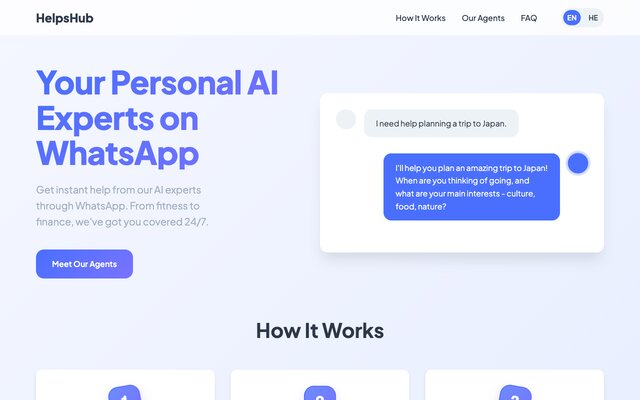

_Take your thing all the way, put it out in the world, and only then form an opinion._

<!-- more -->

This was my first real vibe coding project.

I've already said I play with AI a lot in the free time I don't have. But there's a huge difference between playing by yourself and putting something out there, with users and everything. So I really insisted with myself on going beyond the fast 80% and finishing the job, including the remaining, exhausting 20%.

For me personally, that's the biggest impact AI has on indie developers. The 80% was always easy for me. My problem was always the worlds of design, marketing, writing the copy and so on. I have no doubt it isn't going to replace those professionals, but it really does close that gap and give you "good enough" results. (Which is why I'd be quite worried if I were a mediocre professional.)

## The project, briefly

Briefly, because it's not the point of this post. Over the past year I started training intensely, and after a visit to the doctor I understood I also had to change my diet to match. As someone who had never tracked his weight or what he puts in his mouth, I suddenly needed to know how much protein was in every meal. I needed a "personal assistant" that knows me and is always available, say through WhatsApp.

## Letting go of the reins

Something I tried to emphasize was using AI tools as much as possible, even for the architecture and which frameworks to use. I obviously have opinions there, but I wanted to open my mind and let go of the reins specifically in the places I know, as practice. It paid off at the end of the project, when ChatGPT answered, in my place, the entire email exchange with Paddle about their many questions and comments.

And AI didn't only save me time (or money). In this project I saw how it gives me things I simply wouldn't have thought of. The initial goal was to give myself an easy personal assistant for my training, conveniently through WhatsApp. In our first (uncompromising) brainstorm it had a lot of comments, and thanks to it we arrived at many more bots that could be useful. It built the entire catalog, the images and everything around it, which I'd never have gotten to.

## Finish it

I think that's exactly where AI shines: in the 20% you hate, or wouldn't bother with. So I really push everyone playing with this: if you want to see the biggest added value, take your thing all the way, put it out in the world, and don't form an opinion until you've done that.

The project is at [helps-hub.com](https://helps-hub.com/).

**Update:** the honest outcome is few users. The lesson was that I built the whole thing before anyone asked for it. [Getting people to care is its own project](/blog/2026/02/16/building-it-was-the-easy-part/).

_This post started as a [LinkedIn post](https://www.linkedin.com/posts/shem-magnezi_your-personal-ai-experts-on-whatsapp-activity-7332670431692255232-2GAb)._
