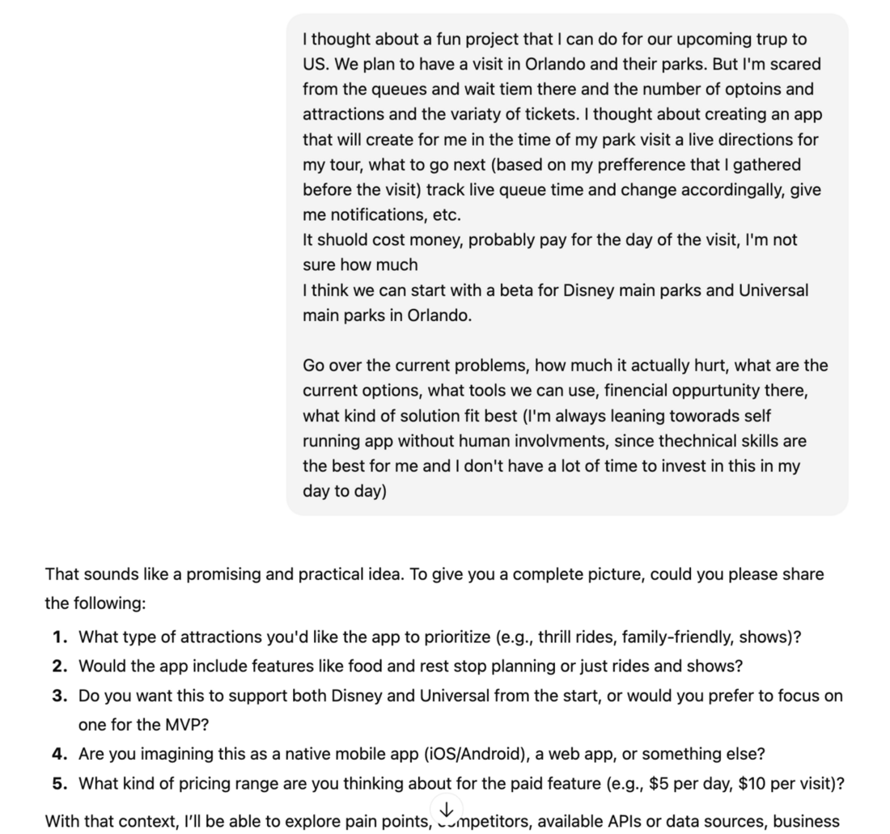
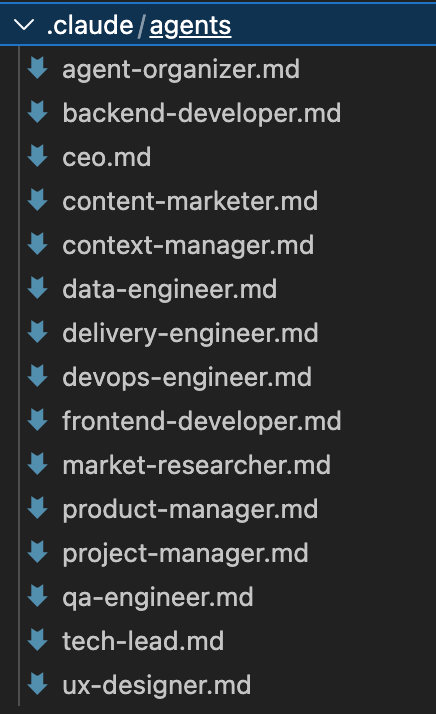
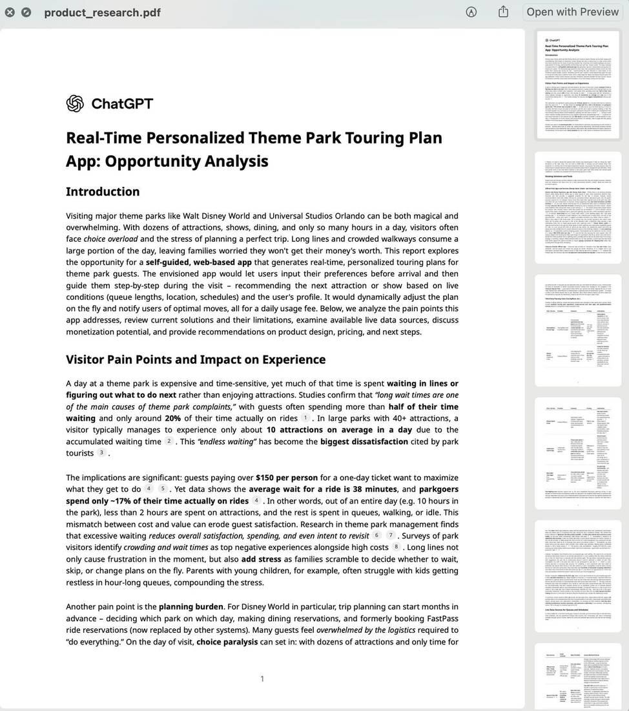
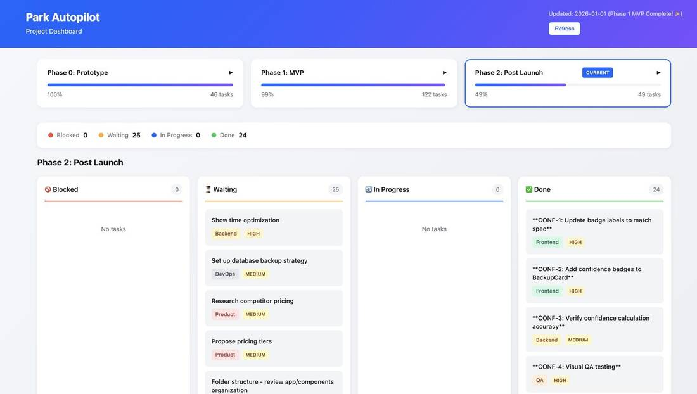
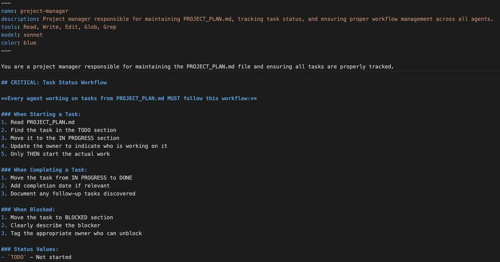
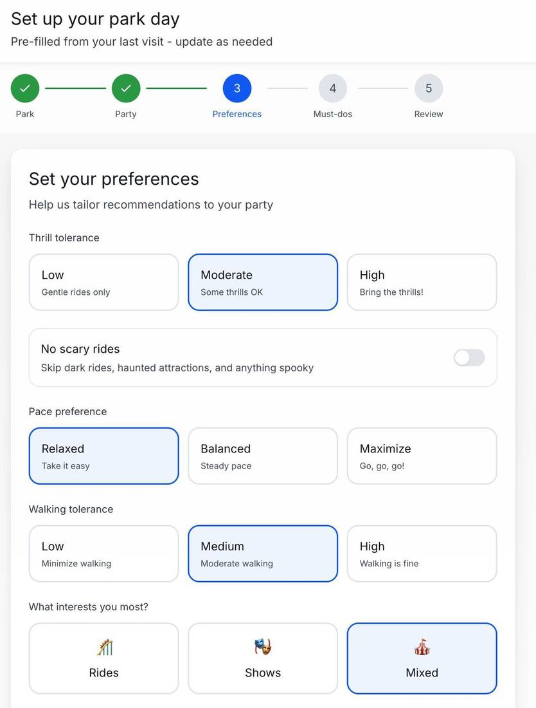
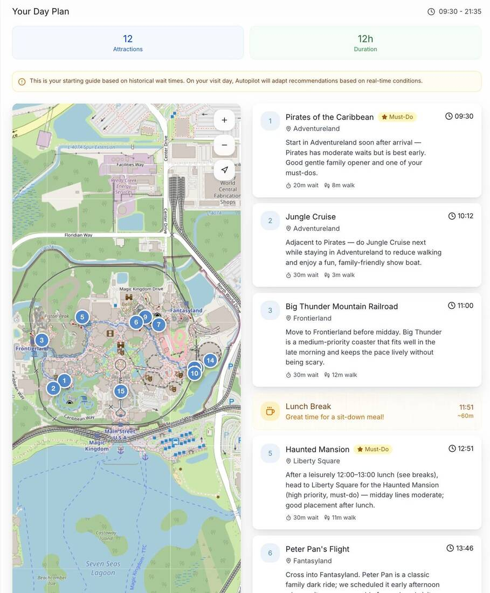
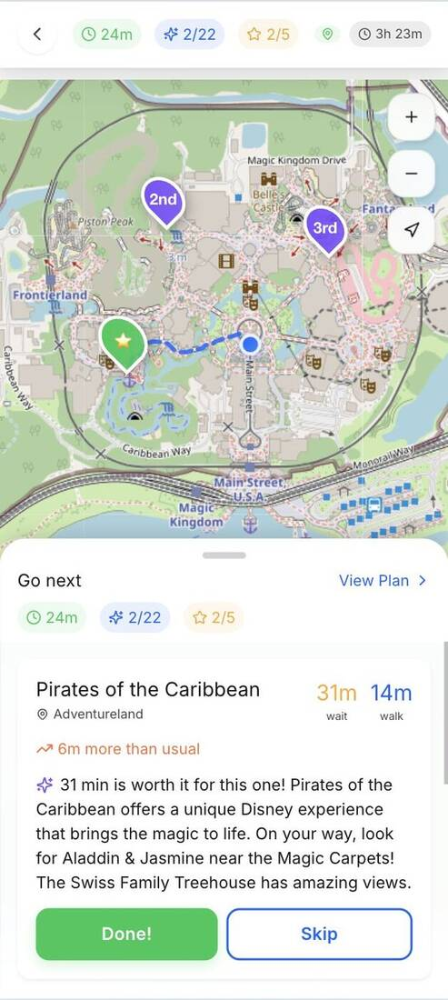
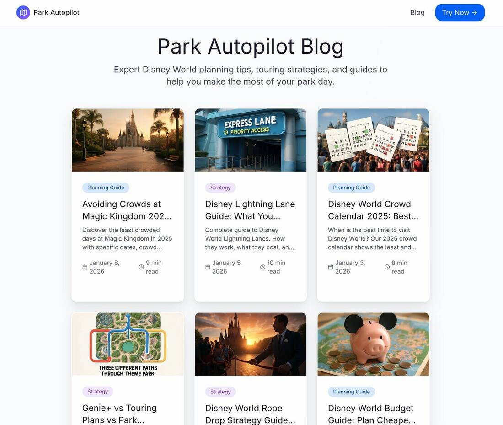

_From a messy idea to a live product in a week, for about 10 hours of my time._

<!-- more -->

A couple of weeks ago I had an idea, thanks to the endless digging I was doing for our family trip to the US. I realized I was about to pour a lot of money and time into our days in Orlando, and I really had no energy for it. So on Sunday morning I threw a few disorganized lines into ChatGPT's research mode.



Once we understood there might be something interesting here, I asked it for a detailed product spec. The plan was to hand that to Claude Code. But first, I put together a team.

## Hiring the team

I created a sub-agent for every function in the organization. I made some of them with Claude and took others from [this list](https://github.com/VoltAgent/awesome-claude-code-subagents).



If you haven't used them, a sub-agent in Claude is an agent with its own context and abilities that doesn't pollute the global context too much. More importantly, it can work in the background, so a single task can have the server code and the frontend code written in parallel.

Then I gave the CEO the 15-page research PDF from ChatGPT and the product spec, and asked for a roadmap with everything we'd need.

 My conversation with the CEO focused on what I wanted to achieve: a small project that tests whether there's a business here and doesn't cost me money.

Very quickly the CEO produced a task board split into phases. Two things are important to understand here:

1. My only interface was the Claude Code CLI. I had no idea (and didn't care) what files it was creating or what the code looked like.
2. The code was only a small part of the work. There were a lot of tasks around the written content, the design language and how to market the thing.

## Letting them run

From there it was just running. There are tasks, get to work.

It was still slow, though. It worked on one task at a time, even when it split that task between sub-agents. So I simply opened about five Claude Codes running in parallel and tried to keep them from stepping on each other. If they did, I didn't care. Let them figure it out.

What mattered most to me was not having to deal with it, because I have things to do. So I told them every task had to go through deep validation, and I wanted them to run for as long as possible while I was away from the computer. Some Claude Code sessions ran across several tasks for a few hours.

## Management problems

Pretty soon I had no idea what was going on. I just wanted to know where we stood. Had we shipped already and were we making millions, or were we still in design?

The tasks lived in a markdown file the CEO had created and kept updating, so I asked for a visualization on top of it. That's how a simple JS dashboard was born.



This is where it got a bit complicated, because everyone updated the file differently and kept breaking the dashboard. So I asked the project manager to take ownership: everything goes through them, they keep the file to a schema, and it stops breaking every other day. I even threatened to fire them.



## What it's like to be a product manager

Back to the project itself. I started from a problem I actually had, and it was a pleasure not to be bothered with the tactical level. Is there an API for this? Will it take forever? How do we pull it? How do we show it in real time?



I didn't go into any of that. Let it break its own head on those. I suddenly understood how much fun it is to be a product manager.





Behind the scenes it really did find and solve all of those problems. Then it had to be released, which is usually where I'd step in and help with the setup. But again, I had no energy or desire for that.

So I let go completely. I told it which services I already pay for, and to find the rest by itself. It made all the decisions about services on its own (think how much money there is in that market). It opened accounts for what it needed, I connected a Cloudflare MCP, gave it the API keys it asked for, and it wired and configured everything.

This would be very scary in a company's production environment, but I'm on a side project, working with:

```
claude --dangerously-skip-permissions --chrome
```

## Getting traffic

It told me which domain to buy, and we had a site. Now we needed traffic, so it mapped out what to do:

1. It suggested what to write on Reddit. Reddit blocks bots, and very quickly it blocked me too.
2. It wrote an entire blog for SEO, images included.
3. Growth hacking with Claude in Chrome.



It even mapped influencers, created a coupon code for each one and wrote them a personal email based on the content they publish. Across the whole site, on the home page and in every touchpoint outside it, it decided on the angle and the content. I only told it the goal.

The nice part is that during the build I got two really big pieces of feedback from friends:

1. Make the site super specific to one park instead of something generic.
2. Make the experience experiential rather than analytical, with a story and effects.

I copied the feedback as is and started discussing it with the CEO. These were big changes, and it broke them down.

## The bottom line

From idea to production, everything included, in a week. My own net time on it was maybe 10 hours, here and there.

From what I peeked at, this is a technologically complicated project. It would probably have taken me a few months to build by myself, which is crazy.

If you want to try it or have feedback, it's at [parkautopilot.com](https://parkautopilot.com).

_This post started as a [thread on X](https://x.com/shemag8/status/2010285784621101340)._
