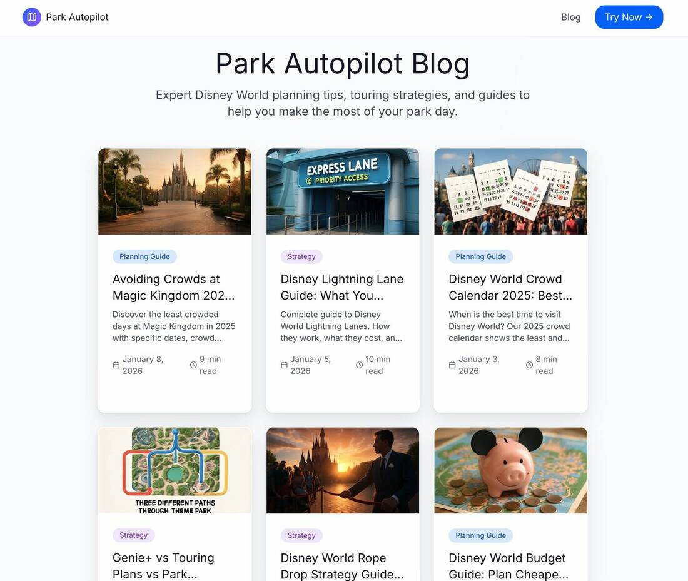

_To bring in a dollar for every fifty cents you spend, you first have to spend thousands without seeing a cent._

<!-- more -->

So you fell for the LinkedIn drugs. You decided to show Avishai the senior engineer that you can work with AI too. Now you're going to have your own fitness app, you're going to make millions on it, and who does he think he is anyway.

A month later, after regretting seven times that you ever opened LinkedIn when you could have been watching recipes on Instagram, you actually managed to make your virtual coach give decent advice, other than eating a kilo and a half of chicken breast at 11pm.

But now what?

This is the part I always got stuck on. As a technical person I had piles of projects that reached the finish line only to stay there. Wonderful products with one user (me). That's the dream and the heartbreak of many people I've talked to lately, who realized that building is only the first piece of the puzzle.

After I finished [the Disney project](/blog/2026/01/11/i-gave-my-side-project-a-ceo/) I thought the army of bots I'd built might be able to help with this too. In the same way we built the product, I asked the CEO to start bringing in some business, because the investors aren't happy. And to do it as cheaply as possible, because the investors have a trip to the US this summer and there isn't much money left.

After the usual things (mostly SEO), this is what we tried:

- **A rich blog** about Disney and people's pain points. It built itself a schedule of posts, like an entire marketing team, based mostly on what people search for.
- **A free countdown.** It spotted a pattern of people posting when they're about to travel, so it built a nice, free countdown for them to share.
- **A referral campaign.** It mapped influencers and sites, opened a referral campaign with a discount, created a coupon code for each one and sent personal emails.
- **Instagram outreach.** It found Instagram influencers who are relatively reachable there and started sending them personal messages.

All of it automated. The ideas were all its own, after my approval. Most of them yield nothing, of course, but marketing is about big numbers and time.

And to be clear, I also had one Claude session reaching out to people on Instagram while another went through user feedback and fixed things. Don't do this. They'll probably block your account at some point.

In the end this isn't magic. It's very, very hard to bring in users and rise above the noise. There are no big shortcuts here, and if you don't have the financial backing to pour piles of money into ads, you'll have to work hard, for a long time.

**Update:** the final tally was about $1,000 in total. Reddit banned me, 60 Disney bloggers brought 0 paying users, and we ended up with 45+ SEO posts and even taxi tablets in Orlando. The building took about 10 hours. The distribution was the real experiment.

_This post started as a [LinkedIn post](https://www.linkedin.com/posts/shem-magnezi_%D7%93%D7%91%D7%A8%D7%99%D7%9D-%D7%A9%D7%90%D7%A0%D7%A9%D7%99%D7%9D-%D7%9C%D7%90-%D7%9E%D7%91%D7%99%D7%A0%D7%99%D7%9D-%D7%91%D7%A9%D7%91%D7%99%D7%9C-%D7%9C%D7%94%D7%9B%D7%A0%D7%99%D7%A1-%D7%93%D7%95%D7%9C%D7%A8-activity-7429117668776984576-XjRx)._
