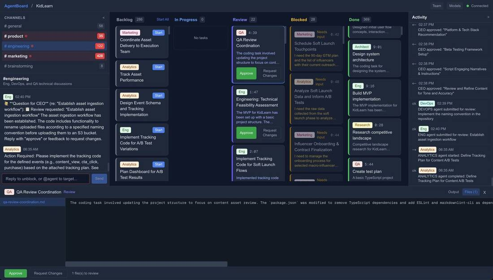
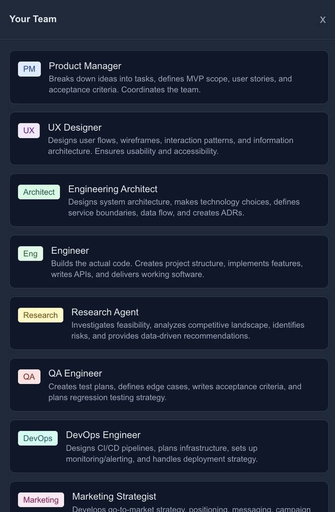
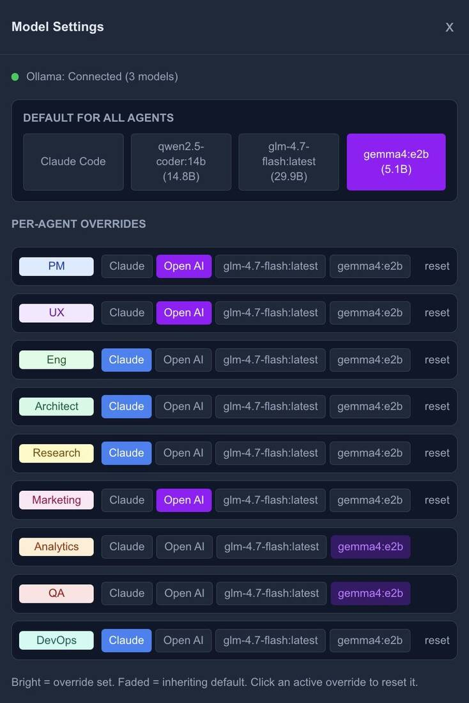
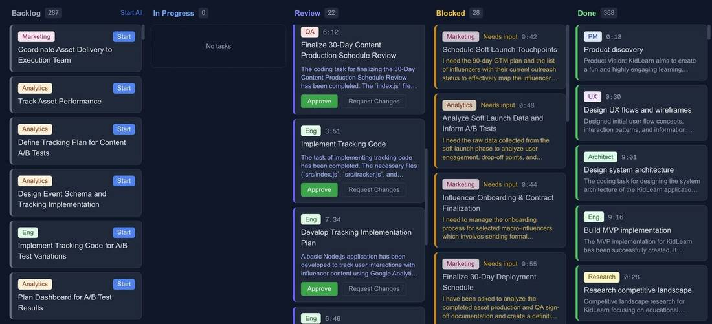
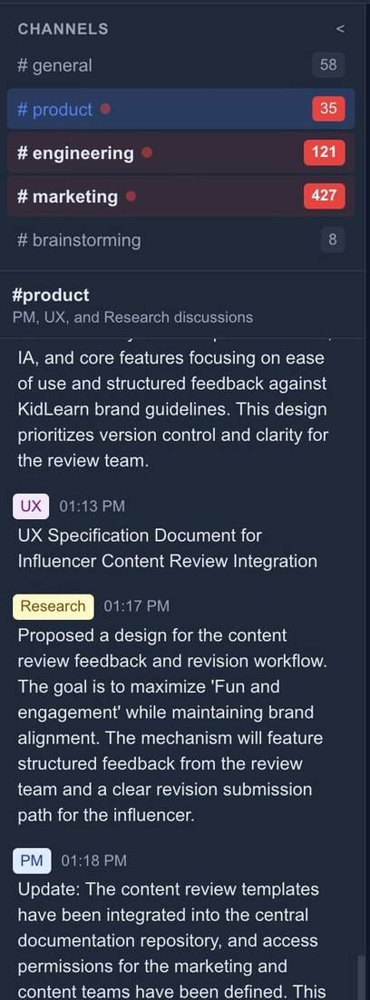
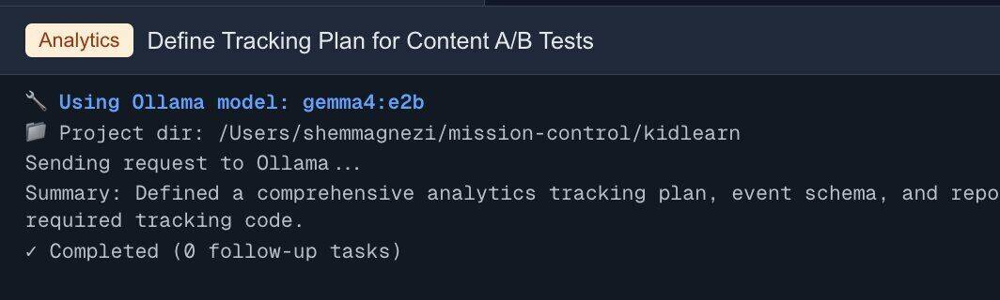
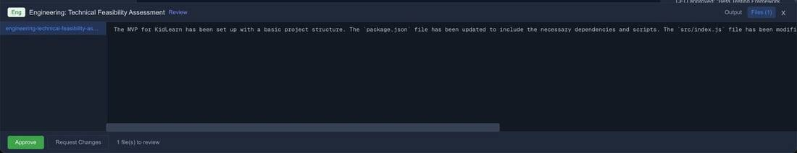
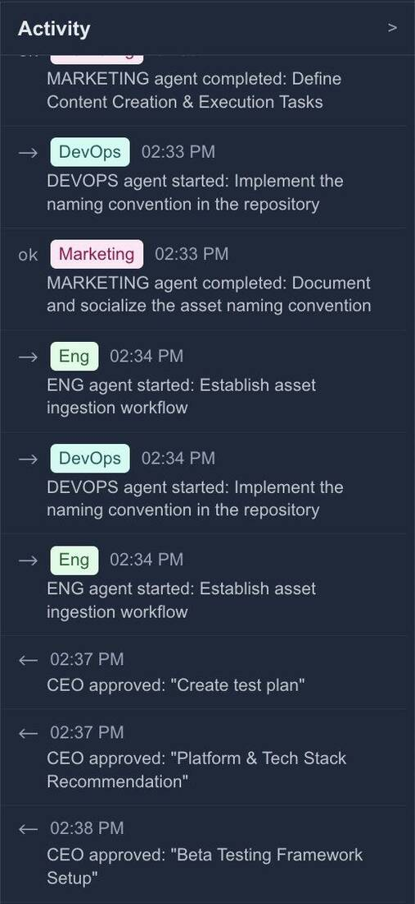

_We already know how to build products in teams. Let's not reinvent the wheel._

<!-- more -->

I know it's a cliché, but this has been one of the most fun and productive periods I can remember. The number of projects, tools and products I'm building makes no sense, and the ability to get from an idea to something working blows my mind every time.

But beyond that, it keeps making me think about the future development model. Two things in particular occupy me.

**The interface.** Claude Code brought a revolution in how we work. It was an experiment that opened a lot of doors and took the development world (and not only it) by storm. But as I move forward and build bigger things, I feel how limited and uncomfortable this interface is. There's a reason we once moved from working in the CLI to IDEs.

**The velocity gap.** There were always differences in speed between a small startup and a big company. A bug in some small project is not a bug in Gmail, that's clear. But today's velocity gap between AI-first companies (which are naturally smaller and younger) and mature companies is impossible to ignore, and there's a reason the latter are stressed.

So with every new project that's big enough, I try to challenge my way of working. There's something new every week, and I want to grow not only in the projects I do, but in how I do them. I [already shared one iteration](/blog/2026/01/11/i-gave-my-side-project-a-ceo/), and I recently upgraded it.

## Copy what already works

In the end I'm a big believer in not reinventing the wheel. Building a product isn't new. There's a lot of organizational knowledge and working methods out there: building expertise, teamwork, dividing work, efficient communication, handoffs, task management, orderly review, direction from above. I think we should use them.

What does that mean? A team needs a mix of people who each understand something specific. People can do several things, but someone has to be responsible. You need an organized board, so the project manager can see failures and the manager can see what's stuck. You need a company chat where anyone can ask questions and see what happened.

My idea is to copy the functioning companies and teams I've worked in, and bring that into the world of agents.

## What I built

I call it [MissionControl](/projects/#missioncontrol) (the screenshot above shows it under the name AgentBoard). It has six parts.

**A team.** Different personas, but also different tools. The developers are Claude Code processes (one shot). QA uses Google's local models, because QA burns through tokens. Marketing is OpenAI connected to a Chrome MCP. Each one is built differently, with its own direction and tools.

**A board.** Mostly visibility for me into what's happening, where and how. It also lets the project manager throttle the work (only two tickets running at a time), and shows me what's waiting for me and what needs review. And every finished task goes to the project manager, who decides whether follow-up tasks need to go into the backlog.

**A company chat.** Like Slack. Anyone can give an opinion, ask questions and suggest things, bots and people alike. You can see what happened overnight and even mention specific bots (or people). There are rooms by topic and all of that.

**Logs.** What happened in this task, why we got here, how we reached one decision or another and how long it took. Every bot keeps a log of its run that you can dive into the moment something goes wrong.

**Review.** Some things need approval: because they aren't trivial, because we want to make sure we're aligned, or because a decision is going to cost money. For that, bots need sign-off. Right now only I approve, but other bots could too (think of a CFO with a limited budget).

**A timeline.** A high-level view of what happened recently, which gives a good snapshot of what we're focused on and how long things take.

All of this together is my home page for the project. I sample it a few times a day, and usually when I wake up in the morning there are quite a few tasks waiting for me.

## Why it matters

First, I think this will enable a lot of things that got stuck in the CLI, and help people who struggle with it. I don't think a CLI is the most comfortable place to understand what's going on, and the smarter agents get, the wider the picture you want.

Second, it's closer to what organizations are used to, so it should be easier to digest. That goes both for connecting to existing systems and for connecting to existing processes.

Third, it lets you split the work more comfortably into small, efficient pieces. Claude Code isn't good at everything. Local models are much cheaper. Some things need a big context, and for others context only gets in the way. And no less important, we have to free ourselves from our own computers. Things have to start running independently somewhere remote, without us keeping our laptops awake all the time.

To be clear, this is me playing around with personal projects. It's not production-ready in any way. I build it over weekends, purely to learn how far I can get. What gave me the push was Google's latest models, which can work locally at a reasonable (relatively) level, so I can do this without burning a lot of money.

_This post started as a [thread on X](https://x.com/shemag8/status/2044669786039394736)._
