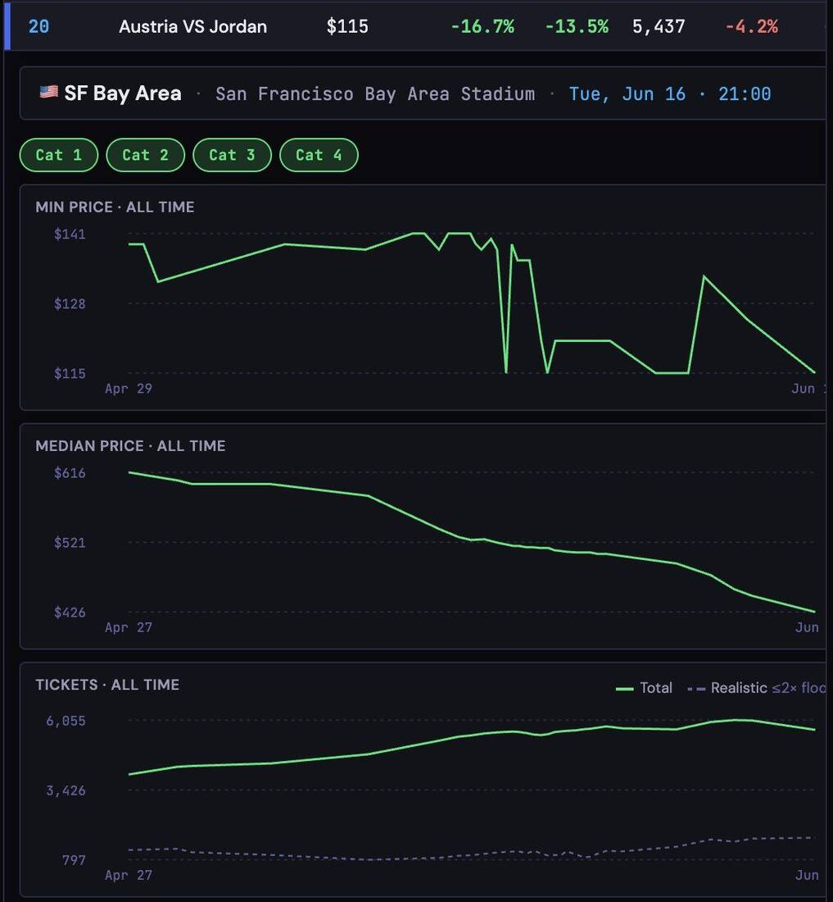
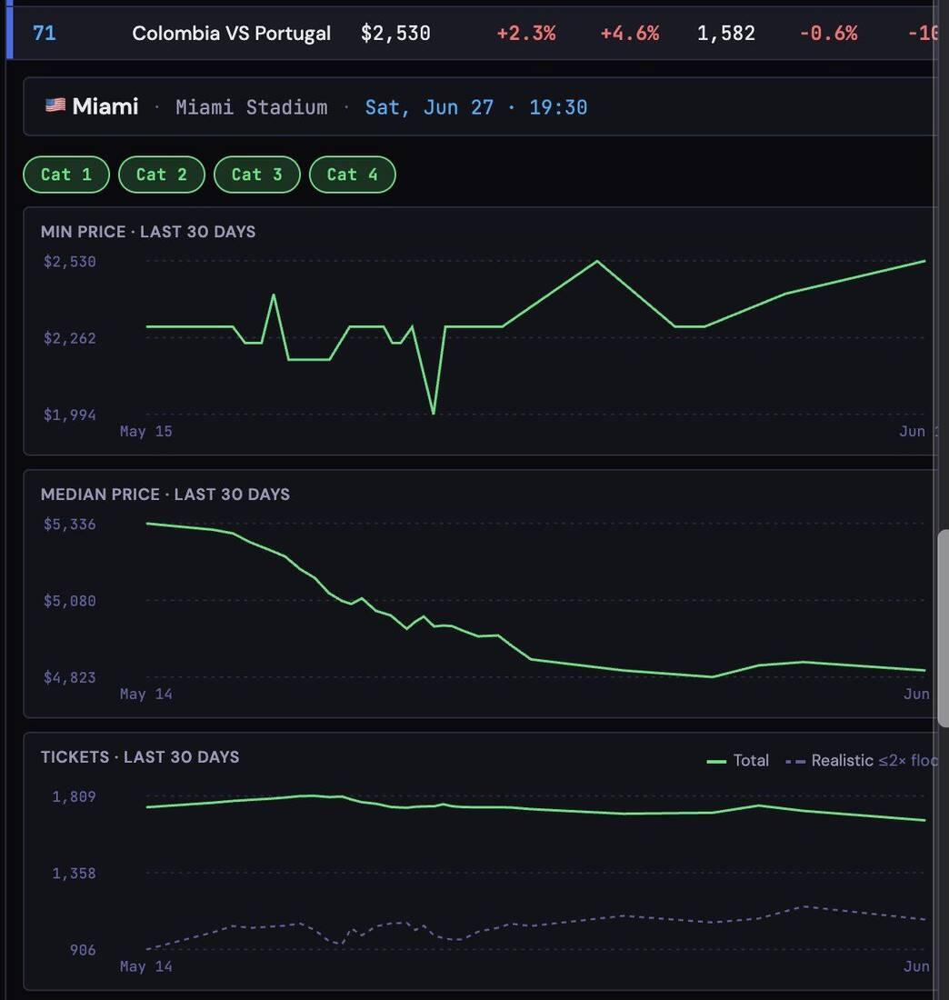
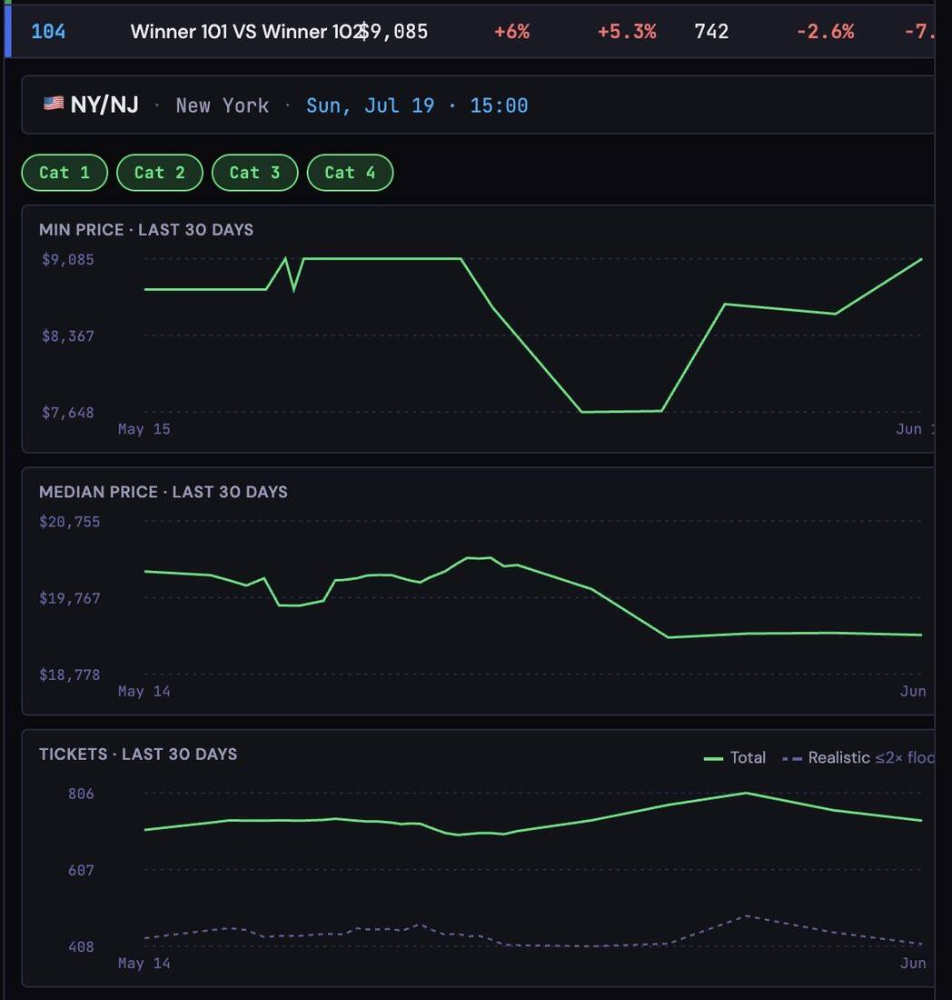
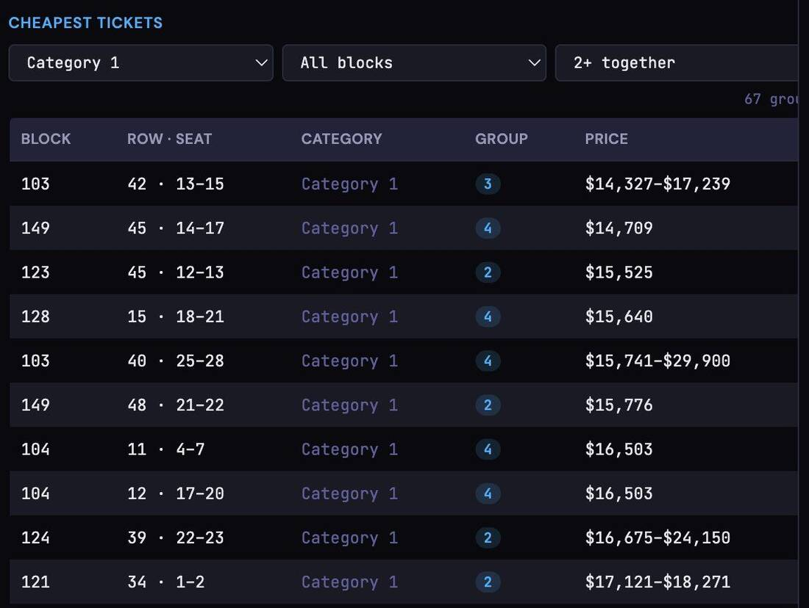
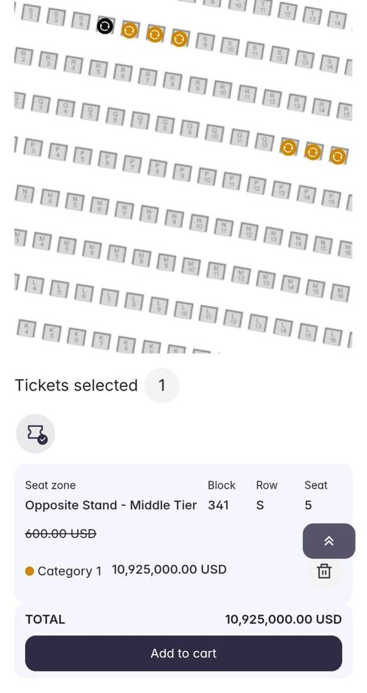
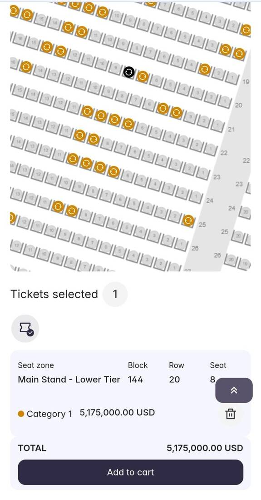
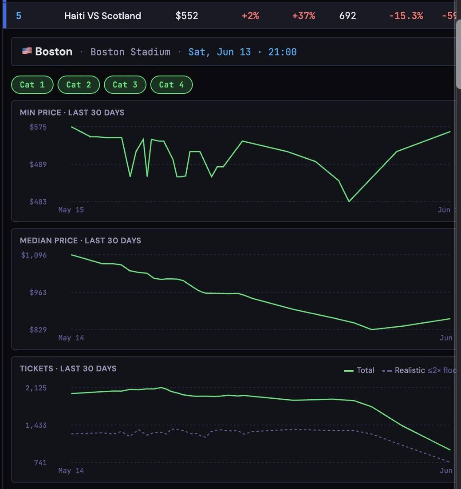

_I just wanted two tickets for my son. Like every side project, it got out of control._

<!-- more -->

A year ago we decided to take the kids to the World Cup. I thought the hard part would be flights and hotels. Wrong. What started as an attempt to get a few tickets for the family turned into a super fun, super nerdy project.

If you haven't been through this, you'd assume you just go to the site and buy a ticket. That's not how it works. FIFA sells tickets through lotteries, different sales rounds and an official secondary market. In some cases you don't even know who's playing in the match you're buying.

We, for example, bought a ticket to a match. There was a date, a stadium and a time. There were no teams. Months later came the draw and we got Germany against Ecuador. We paid for a match without having any idea who'd play in it. Luckily we ended up with good ones. It was worth a lot of money, but very risky.

Meanwhile a huge community of Israelis formed around getting tickets (respect to @FarageMoshe!). People bought for each other, held tickets for each other and helped each other understand the system. And every FIFA drop landed at the worst possible moment: holiday dinners, meetings, Friday dinners and the middle of the night.

You also have to understand that FIFA doesn't only sell the tickets. It also operates the secondary market. So it earns when a ticket is first sold, and again when it's resold. The total commission reaches almost 30% of the transaction. Across hundreds of thousands of tickets, that's a huge money machine.

## Then it got out of control

My son is an England fanatic and was gutted we didn't get them, so we really tried to get an England ticket. I noticed I was opening FIFA's site about 30 times a day, which didn't help, because FIFA's site is terrible. At some point I realized I needed automation.

So I built a small system with Claude. At first it was supposed to do one thing: show me the cheapest price for a pair of tickets. Then I added price tracking. Then inventory tracking. Then history. Then graphs. Then more graphs. Like every side project, it got out of control.

Without meaning to, the system started collecting a daily snapshot of almost the entire World Cup ticket market. How many tickets are available, what they cost, how prices change, which matches are heating up and which are cooling down. Suddenly I wasn't looking at single matches anymore, but at the whole market.

I started posting some of the insights on Reddit. I thought maybe a few dozen people would read them. In practice they turned into discussions with hundreds of comments, people from all over the world started sending me stories and data, and at some point I even found myself talking to journalists trying to understand what was happening to ticket prices.

And in the end I did manage to catch two tickets to the round of 32 in Atlanta (assuming England gets there) at a relatively reasonable price. We can't actually get to Atlanta in the end, but never mind. Goal achieved. And sitting on mountains of data gave me a view that only FIFA has, and doesn't publish.

## What the data shows

These are the prices as of June 11, 2026.

**There are no cheap matches.** Austria against Jordan starts at around $115, Jordan against Algeria at around $119, and Cape Verde against Saudi Arabia at around $138. And those are just the cheapest tickets. Want a reasonable seat, or to sit together? Now you're talking about $300-400.

**Big matches aren't just a bit more expensive.**

| Match | Cheapest | Median |
|---|---|---|
| Germany vs Curaçao | ~$345 | ~$743 |
| France vs Senegal | $539 | $1,144 |
| Argentina vs Algeria | $619 | $1,173 |
| Netherlands vs Japan | $656 | $1,178 |
| England vs Croatia | $747 | $1,460 |
| Scotland vs Brazil (Miami) | ~$1,610 | ~$2,760 |
| Colombia vs Portugal | ~$2,530 | ~$4,600 |

All of that is for group stage games. We haven't even reached the decisive rounds.

**And the final?** The cheapest ticket currently stands at around $9,085. The median is getting close to $20,000. Yes, for one football match.

**The funniest part** was seeing what people try to sell. I saw a ticket to Netherlands against Sweden at $10.9 million, Paraguay against Australia at $5.1 million, round of 16 tickets at almost $8 million, and a ticket to the final at $11.5 million.

**And the best story? Haiti against Scotland.** I'd have sworn it would be a $100 match when I saw the draw. It turns out Scottish fans, who waited decades for a World Cup, organized like an invasion force. They took over a town near Boston, rented a fleet of buses, and private groups popped up just to connect buyers and sellers and get around FIFA's commission.

On top of that, Boston has a large Haitian community that went just as crazy. And suddenly you can see it in the numbers: inventory cut from around 2,100 tickets to fewer than 700. Today the cheapest entry costs around $552, and a regular seat around $850.

The system is still running and collecting data, and I think it's about to get even more interesting. A lot of people waited for the last minute because they were sure prices would drop. So far that isn't happening. On the contrary, lately it sometimes takes half an hour just to get into the marketplace.

Let's hope the tournament justifies it!

_This post started as a [thread on X](https://x.com/shemag8/status/2065030109061677567)._
