_Five anchors, one very long conversation, and an 80-page book._

<!-- more -->

Four years ago, when we realized the World Cup was going to be in the US, my wife announced we were going on a big trip. The kids would be old enough, she had gone independent, and the hope was that work would allow it. We started saving, because we knew it was going to be expensive: a couple with two kids in the US, certainly during a World Cup.

We started planning a year ago, luckily. That gave us enough time to plan such a long trip, and it also saved a *lot* of money.

Most of the trip was planned by AI, and I have to say it was an amazing experience. If I'd had to plan it myself, I wouldn't even know where to start. These are the anchors I gave it:

1. Start in New York (to visit family, and the flights are more convenient).
2. Be at 2-3 World Cup matches in the early, not-expensive stages.
3. Orlando (parks).
4. Miami (for a cruise).
5. St. Louis (to visit family).

That's it. From there it started asking questions, making suggestions and building a route.

## The route

**New York.** Not my first time, but it was the kids' first, and my wife had been only once a long time ago. As befits New York, we did a full week of walking, mostly in Manhattan but this time Brooklyn too. We wanted to squeeze in a show, but that was too much. As a rule, every route also came with a story from ChatGPT.

**Philadelphia.** From there we took a car to our second match. Only two nights, because there isn't a ton to do, but mostly because it was very expensive. It turned out great. We packed everything into two days, learned a lot of American history, the kids watched a Revolutionary War reenactment, we watched Rocky in the evening (doesn't survive the test of time) and ran up the stairs.

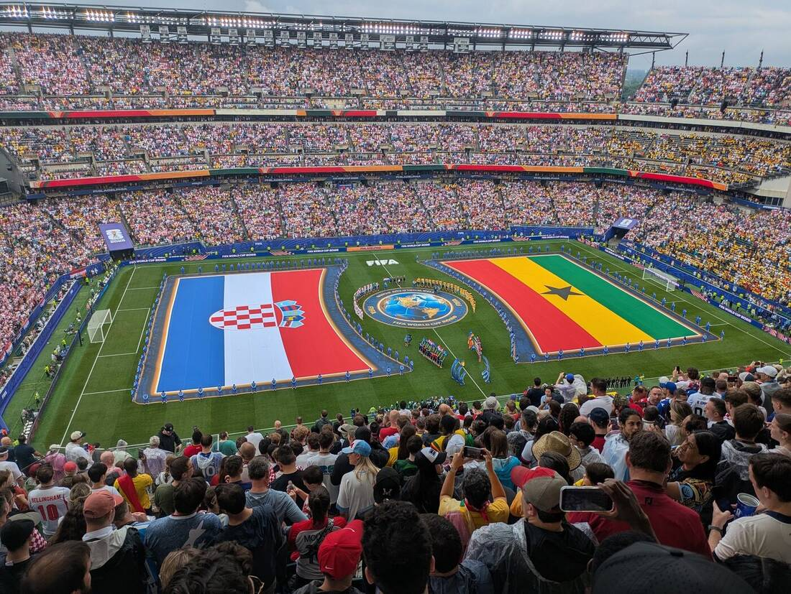

**Hershey, Pennsylvania.** A great example of a place I'd never have thought of going through, and lucky the AI suggested it. A town built entirely around the chocolate factory, plus an amusement park and a huge water park. The area is also surrounded by Amish communities, which was new to us too.

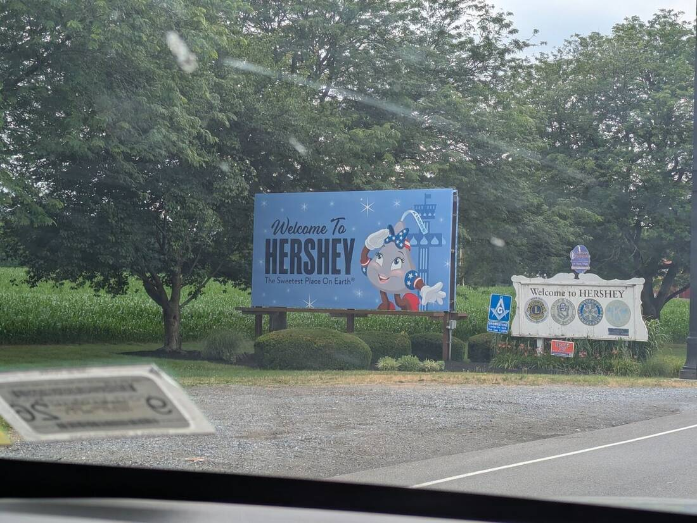

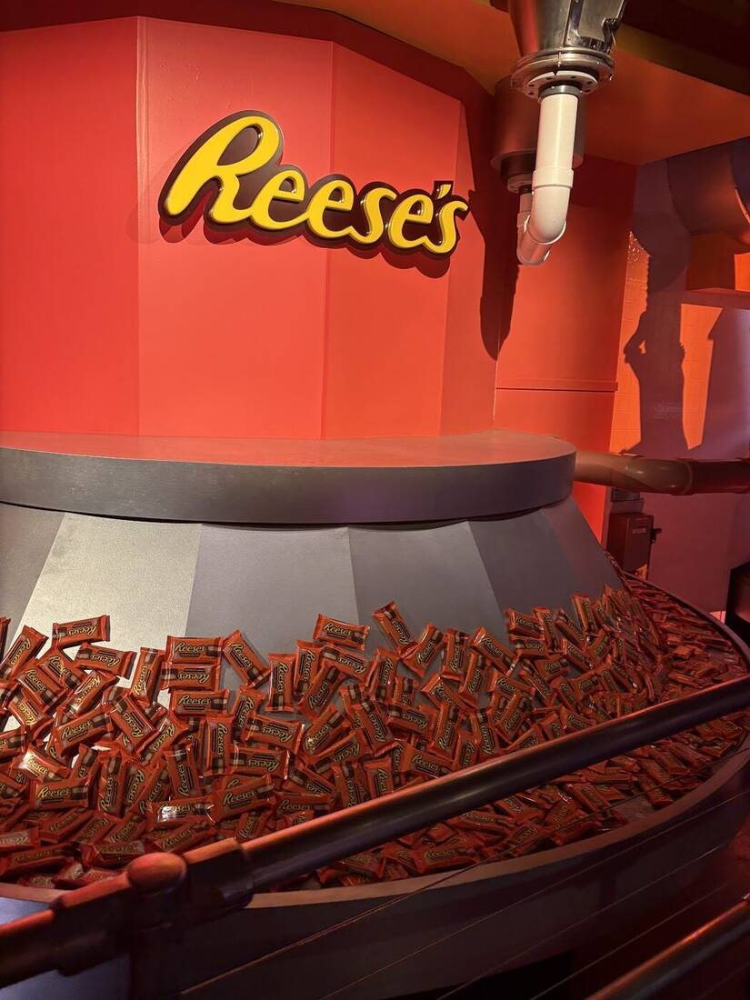

**Washington.** We went for the 250th anniversary celebrations, because Trump promised the biggest fireworks show in the world (and delivered!). It was insanely hot though, and with the crowds that weekend you could hardly move. So we mostly moved from museum to museum and spent time at the hotel's rooftop pool, which turned out to be a great call, because we could see the rehearsals for the flyover that went on all day.

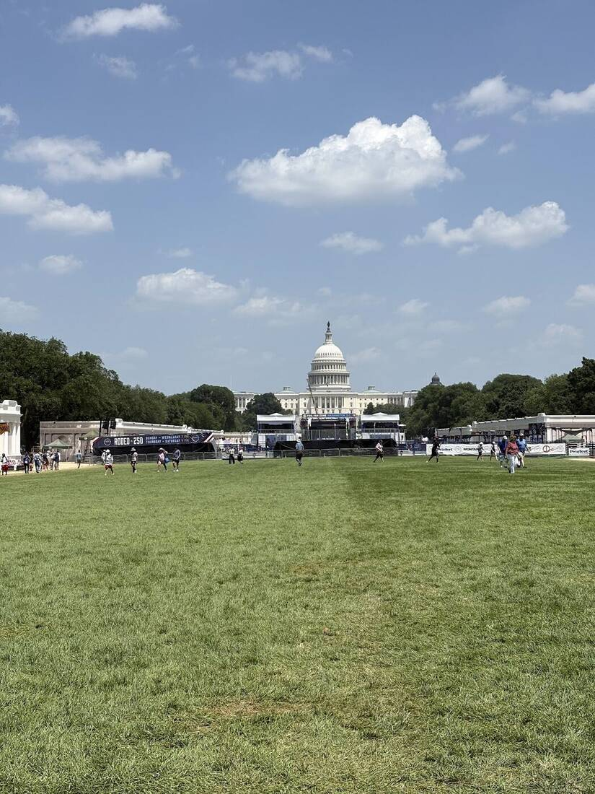

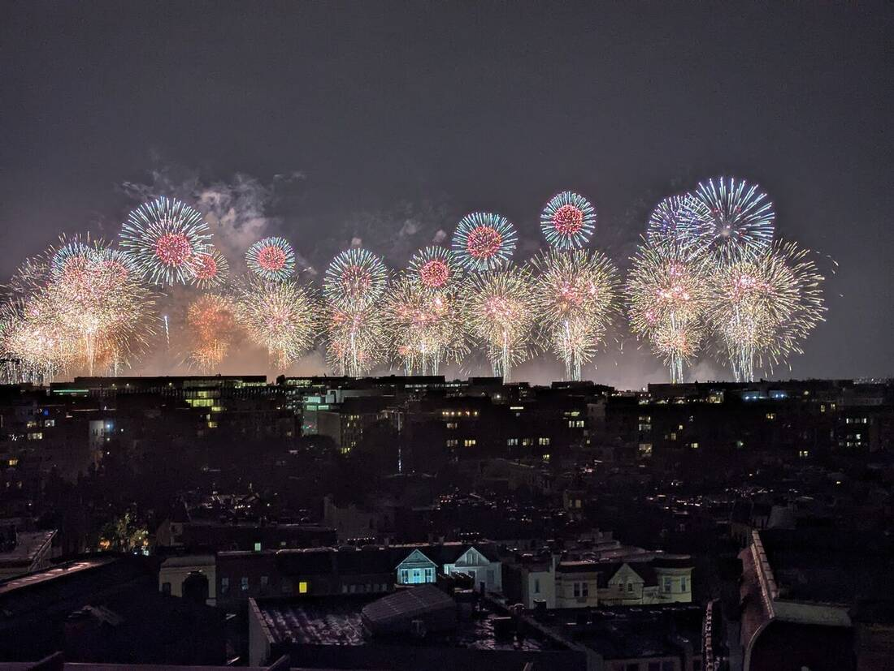

**The long way south.** Yes, you can drive to Florida in a day or two, but we preferred to take our time and see more places: the Carolinas, Savannah, St. Augustine and NASA. Excellent decision. The kids and I didn't suffer through long drives, we saw a different America, and a lot of history. Really fun.

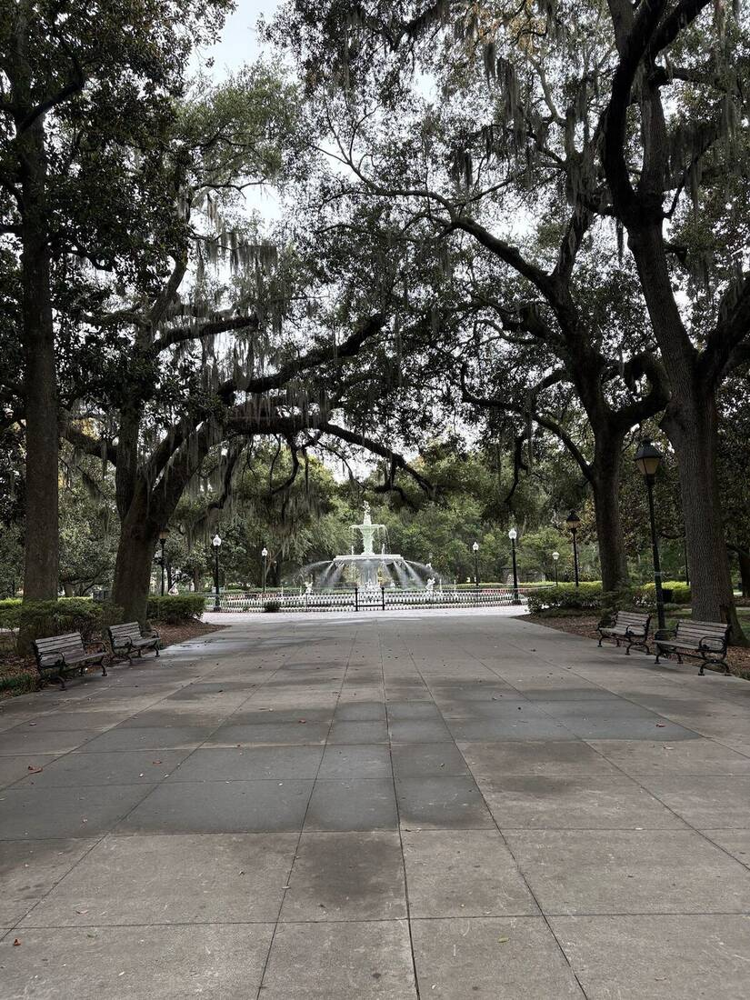

**Orlando.** After endless excitement we arrived, and there's nothing more to say: it really is the happiest place in the world. We did Disney, we did Universal, and between each one we took a rest day at the pool with a lot of shopping. In the parks my wife and I had no less fun than the kids.

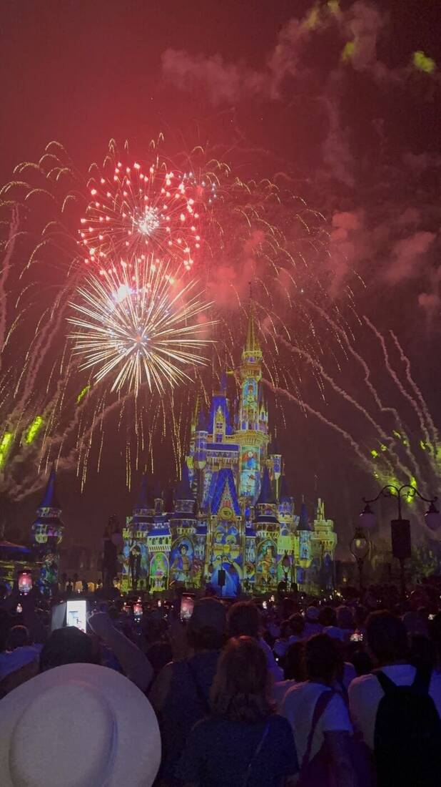

**South again.** We chose not to go straight to Miami. Since we had time we stopped at a cowboy ranch, then a few nights in a villa in Naples, then a villa in Hollywood Beach, and only then Miami.

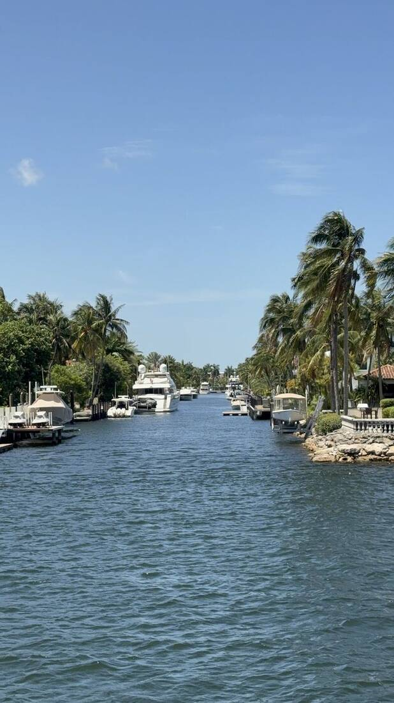

**The cruise.** After all that rest, we went to rest on a cruise. I was very skeptical. I'd never been on one and I was sure I'd get claustrophobia combined with nausea and boredom. Not even close. It was a fucking floating building, with a water park, concert halls, Broadway shows, stand-up and bumper cars(!). Perfect, highly recommended.

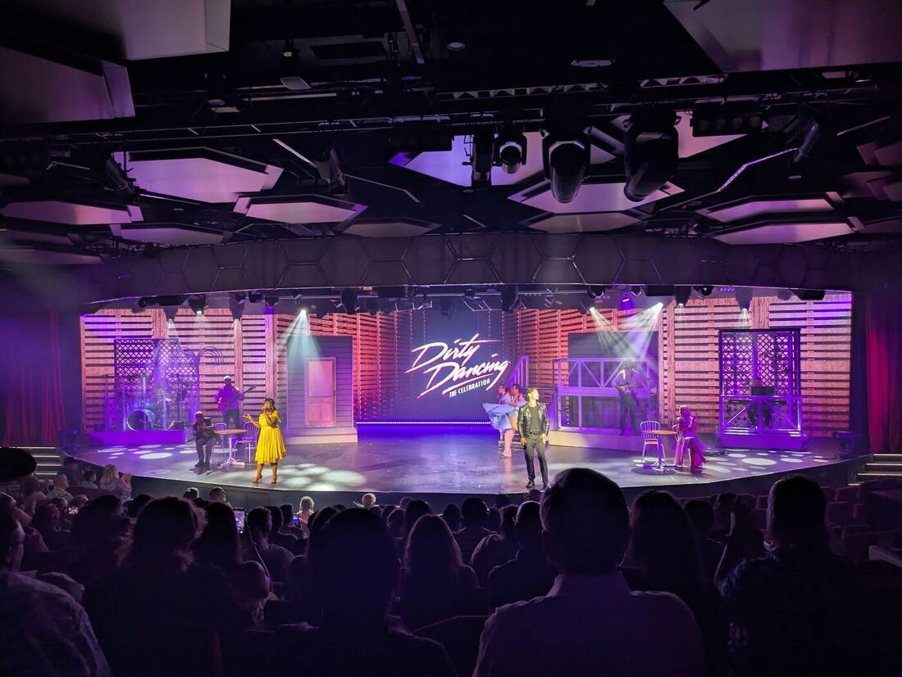

**St. Louis.** Back in Miami we took a flight to St. Louis. It has nothing to do with anything, but we have family there, and I'm glad we didn't give it up. I'd never heard of St. Louis. I couldn't even have pointed to Missouri on a map. As usual, a few days of touring with history and culture from the chat, and a few days resting in a cabin with a private lake just for us.

**Vegas.** The last stop. Personally I can't stand the city, but my wife had never been and it's easier to fly home from there, so we went with it. After two months there isn't much energy left for touring, and everything there is absurdly expensive, so we mostly rested at the pool, ate well and went only to easy, air-conditioned attractions. One exception: the Sphere is a must.

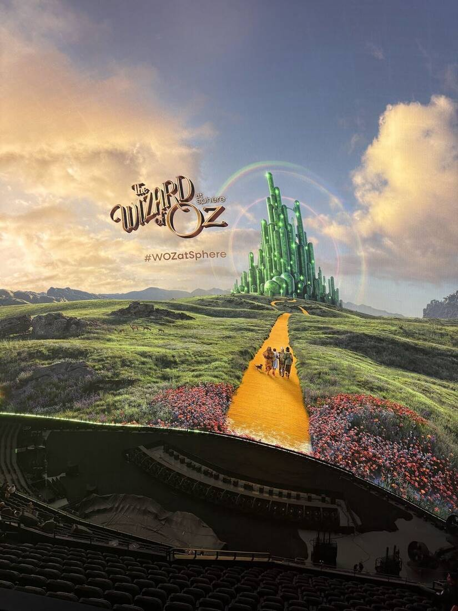

## The book

I said the whole trip was planned with AI, so in honor of the trip we even printed an 80-page book covering the entire route: what to do, anecdotes and so on.

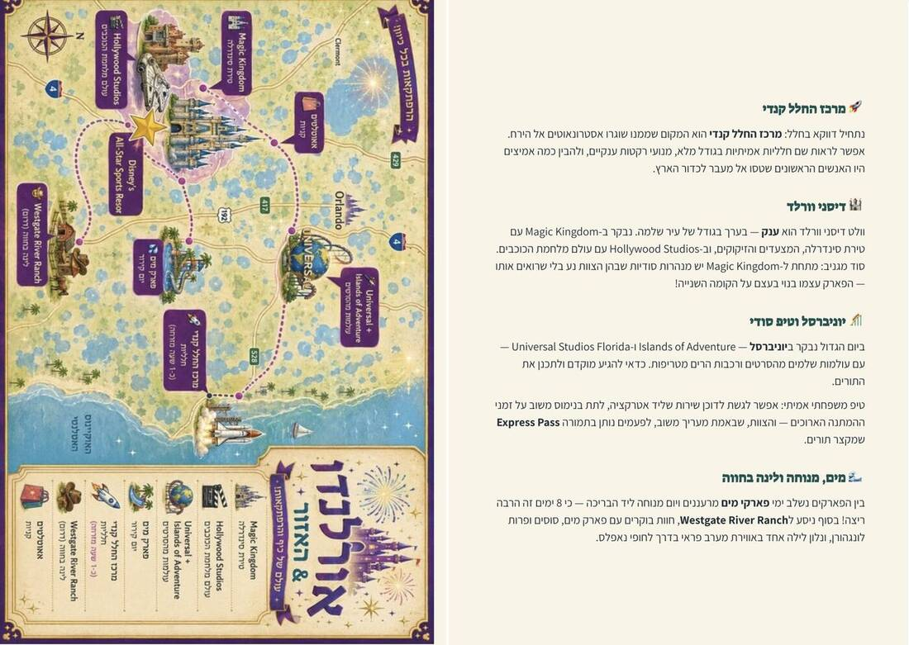

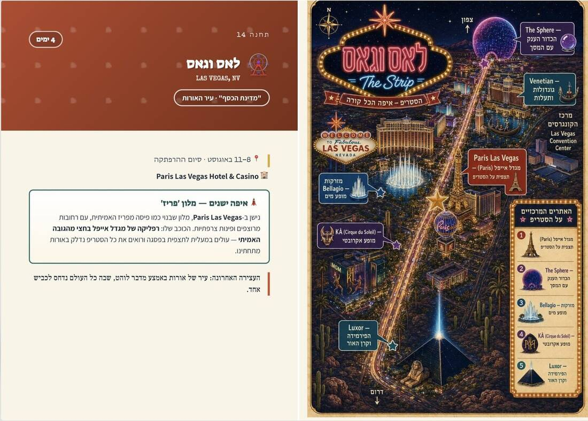

## Was it worth it?

A trip this long has everything: fun and shit and joy and fights and energy and exhaustion, full days and lying-around days. I'm happy we experienced it as a family, even though it isn't simple, and happy we gave ourselves this once-in-a-lifetime experience.

If you're considering something similar, feel free to ask. The costs deserve their own write-up, which I'll get to when I have a bit more time.

_This post started as a [thread on X](https://x.com/shemag8/status/2089054047147827551)._
