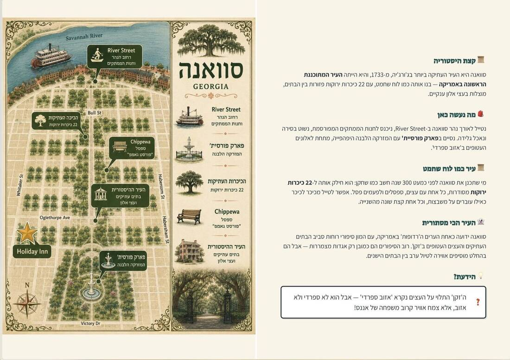

_Five anchors, every booking, the price drops and an 80-page book._

<!-- more -->

This summer we took a two-month family trip across the US, built around the World Cup. AI handled most of the planning, and I have to say it was an amazing experience. If I'd had to plan it myself, I wouldn't even know where to start.

It also went far beyond suggesting a few places to visit. Here's what it actually did.

## It built the route

I didn't hand it an itinerary to polish. I gave it five fixed points:

1. Start in New York (to visit family, and the flights are more convenient).
2. Be at 2-3 World Cup matches in the early, not-expensive stages.
3. Orlando (parks).
4. Miami (for a cruise).
5. St. Louis (to visit family).

That's it. From there it started asking questions, making suggestions and building a route.

The best example is Hershey, Pennsylvania, a place I'd never have thought of going through. Lucky the AI suggested it: a town built entirely around the chocolate factory, with an amusement park and a huge water park, in an area surrounded by Amish communities.

## It planned the days

Once we had a route, it suggested a plan for each day and where to stay.

## It made the bookings

Every hotel, every flight and every restaurant was handled and booked by AI.

That includes the small questions you'd normally leave for later. It wrote to a restaurant in Brooklyn to ask if we could also reserve the bar upstairs after dinner (no, but there's a waiting list you join when you arrive), and what "open until 10pm" really meant (10pm is the last reservation, and they stay open until the last party finishes).

## It handled the boring parts

This is the part I'd have hated most. AI helped me with the car rental, the insurance, the tolls and fees and everything around them.

## It kept hunting for better prices

Booking wasn't the end of it. AI kept monitoring prices, and when one dropped, it got me a better deal.

Here's one real example, five nights at a hotel in Brooklyn, with the same room type and the same dates:

| When | Where | Total |
|---|---|---|
| May 14 | First booking | $1,536.79 |
| May 25 | Rebooked after a drop | $1,509.25 |
| June 3 | Moved to another booking site | $1,408.28 |

That's $128.51 off one stay, without me having to check anything. On June 3 the old booking was cancelled for free and the new one was confirmed a minute apart.

It did the same with flights. Our flight from St. Louis to Las Vegas, for the four of us, went from $735.92 to $499.92 when it rebooked the same flight at the lower price. That's another $236.

Those two bookings alone saved $364.51.

## It helped with the hard parts too

**The parks.** Orlando was going to cost a lot of money and time, and I had no energy for planning it. So that's how [Park Autopilot](/blog/2026/01/11/i-gave-my-side-project-a-ceo/) started.

**The World Cup.** AI also helped me get tickets from FIFA, which turned into [its own story](/blog/2026/06/11/i-accidentally-tracked-the-world-cup-ticket-market/).

## It stayed with us on the road

The help didn't end when we left. As a rule, every route also came with a story from ChatGPT. In St. Louis, a city I'd never heard of (I couldn't even have pointed to Missouri on a map), we spent a few days touring and learning the history and culture with the chat.

## It created the book

AI created a whole 80-page book covering the entire route: what to do, anecdotes and so on. And we printed it.

If you're considering something similar, feel free to ask.

_This post started as a [thread on X](https://x.com/shemag8/status/2089054047147827551)._
